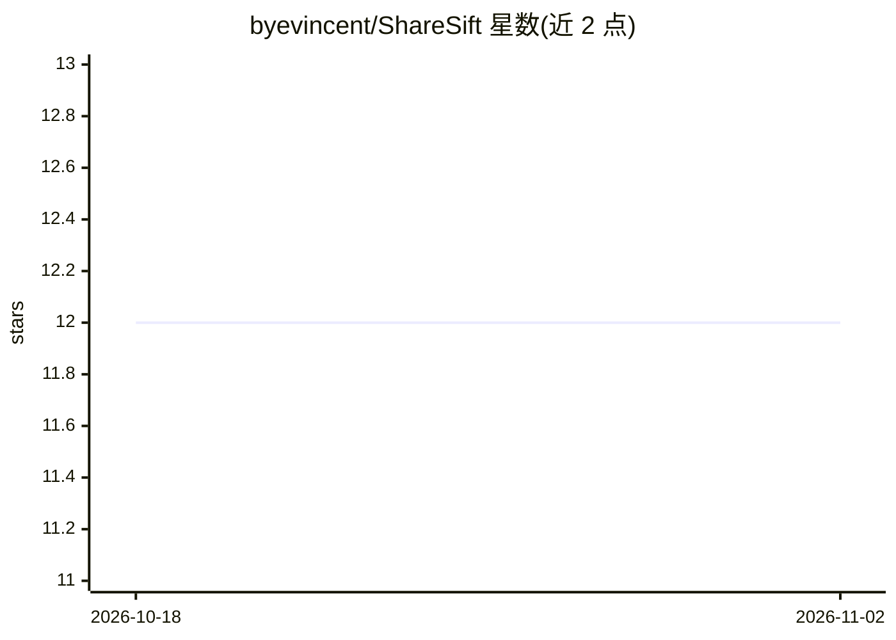

# byevincent/ShareSift

⭐ 12 · Python · Apache-2.0 · 推送 2026-10-07 · [GitHub](https://github.com/byevincent/ShareSift) · [官网](https://vincent03dinh.wordpress.com/) · 个人维护

**红队/渗透测试人员用：按含凭据概率对 SMB 共享文件排序的两阶段分类工具**

面向渗透测试与红队场景的 SMB 共享凭据猎取工具，定位为 Snaffler 的后继。两阶段流水线：Stage 1 用 LightGBM 路径分类器（Windows/Linux 模型）给每个路径打分并分 Black/Red/Yellow 层级，亚毫秒级；Stage 2 用 Qwen3-1.7B LoRA 内容分类器确认标记文件，CPU 上每文件 5-8 秒、CUDA 约 150ms。支持 SMB2/3 直连远程共享（无需挂载）或扫描本地目录，输出 JSONL 与交互式 HTML 报告，并提供 77MB 单文件二进制与 pipx 安装。README 明确列出局限：未在真实 engagements 数据上验证、跨分布泛化下降、稀有凭据类别训练不足。

## 筛选速览

| 维度 | 判定 | 备注 |
|---|---|---|
| AI 角色 | `ai-native` | 本体是模型或模型工具 |
| 许可风险 | `permissive` | Apache-2.0 |
| 部署形态 | `desktop` | 安装包/桌面程序 |
| 模型依赖 | — | README 未给出锁定关系 |
| 硬件要求 | — | 无带数字的原话,不猜 |
| 安装摩擦 | `medium` | 含编译或系统依赖之一 |
| 成熟度 | — | 结构信号不足 |

## 能力要点

- 两阶段分类：LightGBM 路径分类器 + Qwen3-1.7B LoRA 内容分类器
- SMB2/3 直连枚举远程共享，无需本地挂载，netexec 风格认证参数
- 提供约 77MB 单文件二进制（无需 Python 环境）、pipx 与源码三种安装方式
- 输出 JSONL 中间结果与交互式 HTML 报告，支持 pysnaffler 集成

## 适用场景

- 红队/渗透测试中对目标 SMB 共享批量筛选可能含凭据的文件
- 配合 manspider 等枚举工具对路径清单做分级排序
- 扫描已下载/挂载的共享目录并生成 HTML 分诊报告

## 场景标签

`网络安全` · 领域:学习与行业

## 证据(README 行号)

> L9: ShareSift ranks files on SMB shares by likelihood of containing credentials or secrets. Stage 1 runs a LightGBM path
> L15: ShareSift adds an ML layer on top. The path classifier beats Snaffler on recall by 29.3 percentage points on the Sn

## 星数曲线

2026-10-18 12 → 2026-11-02 12（+0）

---
*卡片 v1 · prompt 1.4 · 生成 2026-11-01 · 置信度 high · 依据 README sha `ed9dbbc3ef9b` · [字段定义](../../DATASET.md)*
