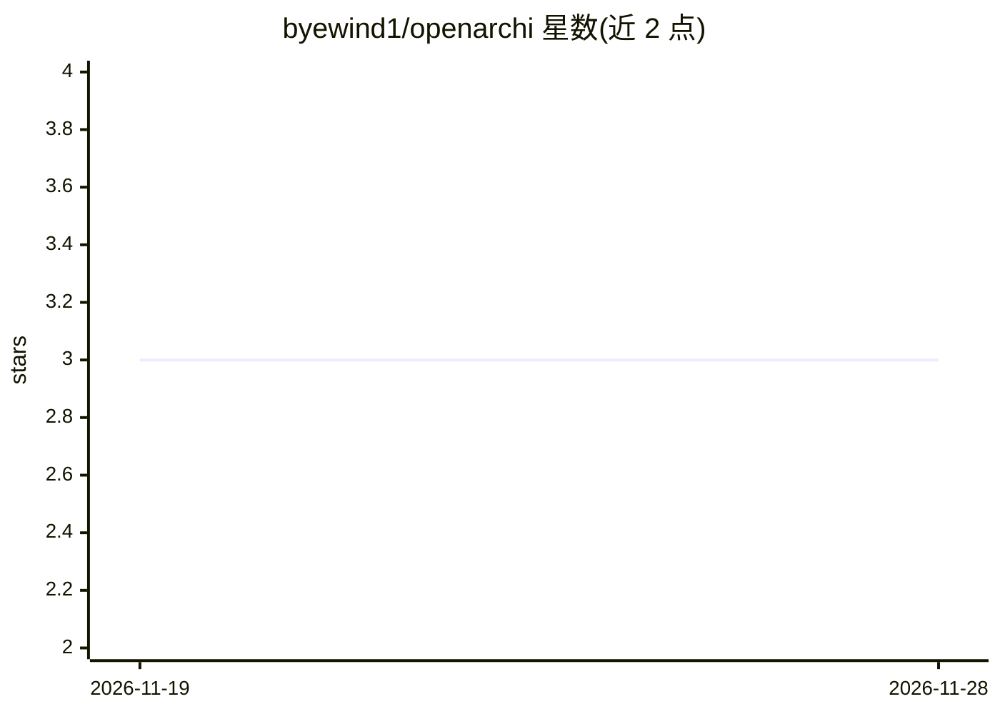

# byewind1/openarchi

⭐ 3 · Rust · Apache-2.0 · 推送 2026-11-27 · [GitHub](https://github.com/byewind1/openarchi) · 个人维护 · 中文 README

**给建筑师的轻量开源 BIM 工作台，AI 共同编辑同一模型**

开源、原生桌面的建筑设计工作台，提供 DWG/DXF 底图导入（二维/三维共享参照）、概念体量推敲、撤销/保存/异常恢复等功能；已接入的 Agent 操作复用共享模型命令，外部接入通过 MCP 适配器（依赖 Unix IPC 与独立 Python 环境）。当前为 0.2.0 早期版本，不承诺能自动完成建筑设计，不宣称替代成熟 BIM 软件用于生产交付；Windows/macOS 提供免安装 ZIP。

## 筛选速览

| 维度 | 判定 | 备注 |
|---|---|---|
| AI 角色 | `ai-enhanced` | 去掉 AI 部分产品仍成立 |
| 许可风险 | `permissive` | Apache-2.0 |
| 部署形态 | `desktop` | 安装包/桌面程序 |
| 模型依赖 | — | README 未给出锁定关系 |
| 硬件要求 | — | 无带数字的原话,不猜 |
| 安装摩擦 | `low` | 无编译、无系统依赖或容器化 |
| 成熟度 | `idea` | |

## 能力要点

- DWG/DXF 底图导入，二维与三维引用同一份底图
- 概念体量创建与编辑，二维/三维间调整方案
- Agent 操作复用共享模型命令，经 MCP 适配器接入
- 撤销/重做/保存/异常恢复等基础工作流

## 适用场景

- 从 DWG 底图开始做概念方案推敲
- 让 AI Agent 在同一份可编辑模型上协助操作
- 在早期阶段探索 AI 与建筑师协作的 BIM 流程

## 场景标签

 · 领域:建筑工程/CAD

## 证据(README 行号)

> L3: 一个开源、原生桌面的建筑设计工作台，探索让建筑师与 AI 在同一份可编辑模型上共同工作。
> L13: - **保存并继续**：支持撤销、重做、保存、重新打开及异常恢复。已接入的 Agent 操作复用共享模型命令；不能自动完成建筑设计。
> L44: 本版不承诺各平台 Agent 接入能力完全相同。当前外部 MCP 适配器依赖 Unix IPC 和独立 Python 环境；Windows 桌面建模与该接入能力分别验证。

## 星数曲线

2026-11-19 3 → 2026-11-28 3（+0）

---
*卡片 v1 · prompt 1.4 · 生成 2026-11-22 · 置信度 high · 依据 README sha `b0aee7979abc` · [字段定义](../../DATASET.md)*
