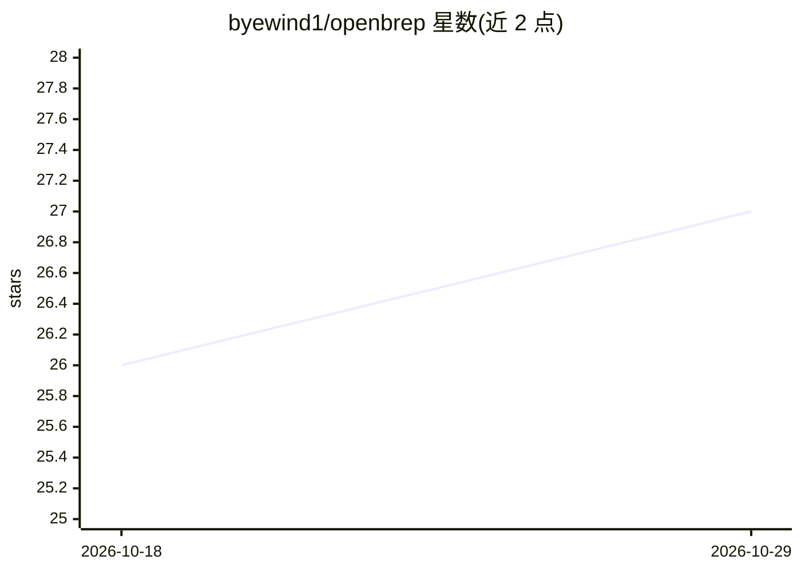

# byewind1/openbrep

⭐ 27 · Python · MIT · 推送 2026-10-09 · [GitHub](https://github.com/byewind1/openbrep) · 个人维护 · 中文 README

**面向 ArchiCAD/GDL 开发者的 AI 工作台：自然语言生成、编译验证 GDL 对象**

OpenBrep 是面向 ArchiCAD 高阶用户与 GDL 开发者的全栈桌面 AI 工作台：以中文/英文描述需求，由 LLM 生成或修改 6 类 GDL 脚本与参数表，经 Mock 或真实 LP_XMLConverter 编译为 .gsm 拖入 ArchiCAD；也可导入已有 .gsm（解包为 HSF）让 AI 调试重构。架构为 React 前端 + Python 后端 Agent Runtime + Tauri 桌面壳。支持图片识别几何生成脚本、计划/执行分离、只读顾问模式，兼容 Claude/GLM/GPT/DeepSeek/Gemini/Ollama 等模型。提供 macOS/Windows 桌面安装包、pipx/uv/源码安装与 CLI 模式；真实编译需本机安装 ArchiCAD 28/29，macOS 包未签名需手动移除隔离属性。

## 筛选速览

| 维度 | 判定 | 备注 |
|---|---|---|
| AI 角色 | `ai-native` | 本体是模型或模型工具 |
| 许可风险 | `permissive` | MIT |
| 部署形态 | `desktop` | 安装包/桌面程序 |
| 模型依赖 | local-ok | 支持本地模型 |
| 硬件要求 | — | 无带数字的原话,不猜 |
| 安装摩擦 | `low` | 无编译、无系统依赖或容器化 |
| 成熟度 | `idea` | |

## 能力要点

- 自然语言/图片生成 GDL 脚本并一键编译为 .gsm
- 以 HSF 为原生格式，AI 只读取与任务相关的脚本以减少 context 占用
- 计划/执行分离与只读顾问守卫，计划失败不执行
- 多模型支持：Claude/GLM/GPT/DeepSeek/Gemini/Ollama 本地

## 适用场景

- 用自然语言创建/修改 ArchiCAD 库对象并导出 .gsm
- 导入已有 .gsm 让 AI 帮忙 debug、重构、加参数
- 上传建筑构件图片直接生成参数化 GDL 脚本

## 场景标签

`代码生成` · 领域:编码与开发

## 证据(README 行号)

> L30: 描述需求（中文/英文皆可）→ AI 生成并填入脚本框 → 一键编译 → .gsm 拖入 ArchiCAD
> L187: |**🖼️ 图片即意图**|上传建筑构件图片 → AI 识别几何、提取参数化维度 → 直接生成 GDL 脚本，无需文字描述|
> L193: |**多模型支持**|Claude / GLM / GPT / DeepSeek / Gemini / Ollama 本地，侧边栏切换|

## 星数曲线

2026-10-18 26 → 2026-10-29 27（+1）

---
*卡片 v1 · prompt 1.4 · 生成 2026-10-26 · 置信度 mid · 依据 README sha `d1af73f63d8f` · [字段定义](../../DATASET.md)*
