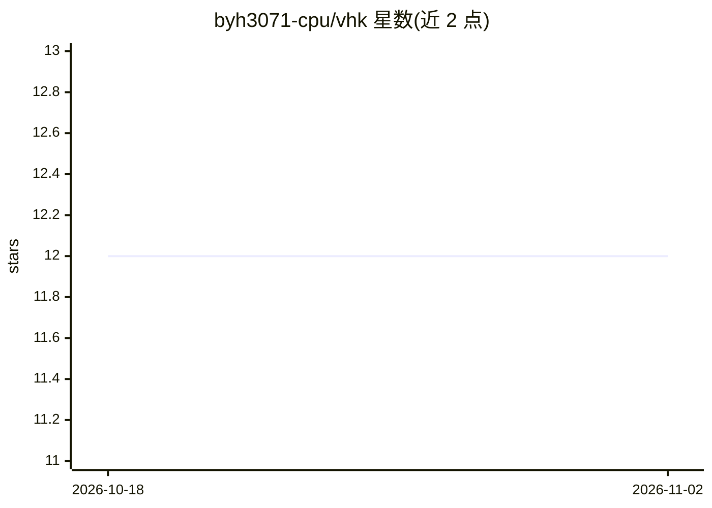

# byh3071-cpu/vhk

⭐ 12 · TypeScript · MIT · 推送 2026-10-21 · [GitHub](https://github.com/byh3071-cpu/vhk) · [官网](https://yohanstudio.co/vhk) · 个人维护 · 中文 README

**韩语 CLI：用目标、证据、记忆与规则包裹 AI 编码代理的全周期工具链**

VHK 是韩国语优先的 npm CLI，运行在 Claude Code、Cursor 等既有编码代理之上：将 RULES.md 同步到 8 个代理规则文件（.cursorrules、CLAUDE.md 等），以 goals/*.md 固定目标，用 verify/review/preflight/receipt 命令基于 git SHA、dirty 状态、测试等机器证据区分“声称完成”与“实际完成”，blocker 3 次触发 HARD_STOP，会话记忆存入 .vhk/memory.json 并可升格为规则。执行策略默认 off，仅查询判定不自动执行。需要 Node.js 22 以上。

## 筛选速览

| 维度 | 判定 | 备注 |
|---|---|---|
| AI 角色 | `ai-ecosystem` | LLM/agent 周边工具 |
| 许可风险 | `permissive` | MIT |
| 部署形态 | `library` | 以包/库形式分发 |
| 模型依赖 | — | README 未给出锁定关系 |
| 硬件要求 | — | 无带数字的原话,不猜 |
| 安装摩擦 | `low` | 无编译、无系统依赖或容器化 |
| 成熟度 | — | 结构信号不足 |

## 能力要点

- RULES.md 单一来源同步到 8 个代理规则文件，代理切换后规则保留在 repo 中
- verify/receipt 以 git SHA、dirty、测试等机器证据判定完成状态（不依赖 LLM 推理）
- blocker 累积 3 次生成 .vhk/HARD_STOP 中止推进
- 执行策略默认 off，policy show/check 为只读判定

## 适用场景

- 让 AI 编码代理的完成声明接受机器证据核验
- 跨 Claude Code / Cursor 等工具统一维护项目规则与记忆
- 以 Goal 与依赖关系管理多任务，阻断重复失败的推进

## 场景标签

`Agent 记忆` · 领域:Agent 开发

## 证据(README 行号)

> L26: > VHK는 새 코딩 에이전트가 **아닙니다.** 이미 쓰는 에이전트를 감싸 "무엇을 하기로 했는지 · 정말 끝났는지 · 다음 세션이 어디서 이어질지"를 repo 안의 파일과 CLI 게이트로 고정하는 하네스
> L11: Claude Code든 Cursor든 그 위에 얹어 리뷰·검증·기억을 한 루프로 돌리고,

## 星数曲线

2026-10-18 12 → 2026-11-02 12（+0）

---
*卡片 v1 · prompt 1.4 · 生成 2026-11-01 · 置信度 high · 依据 README sha `0d781fc28bfd` · [字段定义](../../DATASET.md)*
