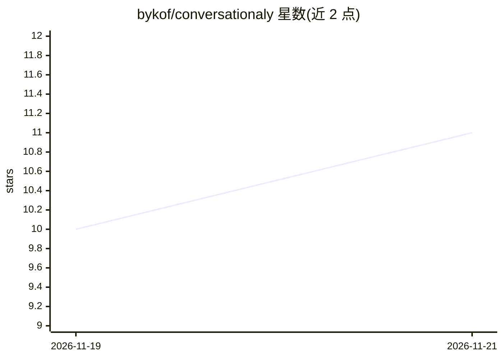

# bykof/conversationaly

⭐ 11 · Rust · MIT · 推送 2026-08-26 · [GitHub](https://github.com/bykof/conversationaly) · 个人维护

**本地运行的 AI 会议助手：录音、实时转录与摘要不出机器**

基于 Tauri 的跨平台桌面应用，捕获麦克风与系统音频，会议进行中实时输出转录文本并生成摘要；转录模型与摘要 LLM 默认在本地运行，核心由 Rust 实现，转录使用 transcribe.cpp，内置 llama.cpp sidecar 直接运行 Gemma 4 做摘要，无需 Ollama。也可按功能逐项选择云端 STT 或云端 LLM（需自行配置）。数据存于本地 SQLite，无账号、无遥测；安装包未做代码签名。

## 筛选速览

| 维度 | 判定 | 备注 |
|---|---|---|
| AI 角色 | `ai-native` | 本体是模型或模型工具 |
| 许可风险 | `permissive` | MIT |
| 部署形态 | `desktop` | 安装包/桌面程序 |
| 模型依赖 | local-ok | 支持本地模型 |
| 硬件要求 | — | 无带数字的原话,不猜 |
| 安装摩擦 | `medium` | 含编译或系统依赖之一 |
| 成熟度 | — | 结构信号不足 |

## 能力要点

- 16 个模型家族共 85 个本地转录模型按需下载，支持流式实时转录
- 内置 llama-helper sidecar 本地运行 Gemma 4 生成摘要，亦可直接转录音频
- GPU 加速覆盖 Metal、CUDA、Vulkan、ROCm
- 录音、转录、摘要全流程本地完成，云端为可选逐项开启

## 适用场景

- 会议中实时生成字幕与转录文本，会后自动写纪要
- 隐私敏感场景下离线处理会议录音与摘要
- 用不同模型重新转录已有音频文件或切换摘要语言

## 场景标签

`AI 助手` `语音识别` · 领域:对话与助手

## 证据(README 行号)

> L17: Conversationaly is a desktop app (macOS, Windows, Linux) that captures your microphone and system audio, transcribe
> L25: - **Built-in AI, no Ollama required** — a bundled `llama-helper` sidecar runs Gemma 4 locally for summaries, and ca
> L89: A single Tauri application: a Rust core (audio capture, transcription, storage, summary orchestration) and a Next.j

## 星数曲线

2026-11-19 10 → 2026-11-21 11（+1）

---
*卡片 v1 · prompt 1.4 · 生成 2026-11-19 · 置信度 high · 依据 README sha `96bed84e571c` · [字段定义](../../DATASET.md)*
