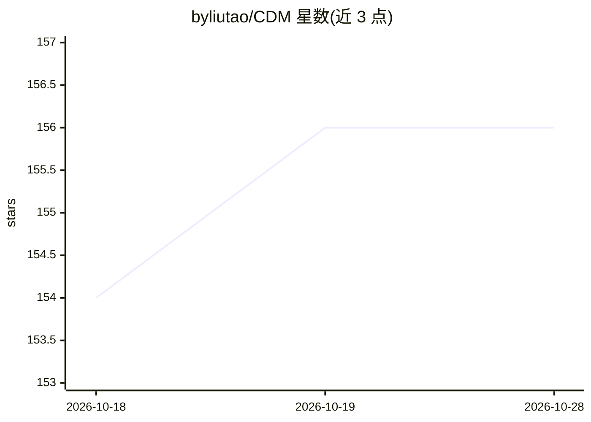

# byliutao/CDM

⭐ 157 · Python · MIT · 推送 2026-05-11 · [GitHub](https://github.com/byliutao/CDM) · 个人维护

**少步扩散蒸馏方法：4 NFE 高质量文生图（NeurIPS 2026）**

NeurIPS 2026 论文 Continuous-Time Distribution Matching (CDM) 的官方代码：通过连续时间调度在反向模拟中采样中间锚点，配合 CFG 增广与分布匹配对齐文本-图像条件和数据分布，并用预测速度外推离轨迹潜变量以解决锚点间不一致。面向扩散模型研究者的训练/推理/评测代码，产出 4 NFE 生成的 SD3-Medium 与 LongCat 蒸馏模型（Hugging Face 提供），提供分环境 conda 流程与 MIT 许可。

## 筛选速览

| 维度 | 判定 | 备注 |
|---|---|---|
| AI 角色 | `ai-native` | 本体是模型或模型工具 |
| 许可风险 | `permissive` | MIT |
| 部署形态 | `None` |  |
| 模型依赖 | — | README 未给出锁定关系 |
| 硬件要求 | — | 无带数字的原话,不猜 |
| 安装摩擦 | `low` | 无编译、无系统依赖或容器化 |
| 成熟度 | — | 结构信号不足 |

## 能力要点

- 连续时间调度下的分布匹配蒸馏目标
- CFG 增广与速度外推处理锚点间不一致
- 4 NFE 生成 SD3-Medium 与 LongCat 蒸馏模型
- 训练、推理、评测三阶段独立代码流程

## 适用场景

- 复现论文中 4-NFE 少步生成的蒸馏结果
- 在自己的扩散模型上做少步蒸馏训练
- 下载已发布的 Turbo 模型直接做快速文生图推理

## 场景标签

`图像生成` · 领域:内容生成

## 证据(README 行号)

> L30:  Pipeline overview of Continuous-Time Distribution Matching
> L32: **Overview of Continuous-Time Distribution Matching (CDM).** **Top:** Our approach employs a dynamic continuous tim
> L26:  Teaser: High-quality images generated with only 4 NFE

## 星数曲线

2026-10-18 154 → 2026-10-28 156（+2）

---
*卡片 v1 · prompt 1.4 · 生成 2026-10-22 · 置信度 high · 依据 README sha `aa9937c91c88` · [字段定义](../../DATASET.md)*
