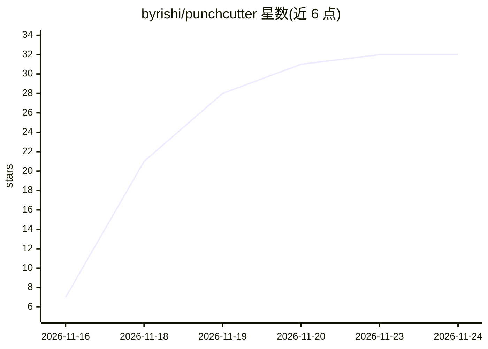

# byrishi/punchcutter

⭐ 35 · Python · MIT · 推送 2026-11-15 · [GitHub](https://github.com/byrishi/punchcutter) · [官网](https://byrishi.github.io/punchcutter/) · 个人维护

**在 Claude/ChatGPT/Codex 等 agent 内运行的字体铸造工具**

以 agent 技能 / MCP 服务器 / CLI 三种形态提供的字体生成工具：用户用一句话描述或提交手写字拍照，工具按 9 个阶段执行绘制、间距计算、kerning、编译（fontmake）与 QA，产出可变字体、TTF/OTF/WOFF2、UFO 源文件及单文件 Studio 试样应用。支持 Claude Code 插件、Claude 应用技能上传、MCP 客户端（Claude Desktop/Cursor/Windsurf）、ChatGPT 远程 MCP、Codex 技能，也可完全不用 AI 直接 CLI 运行。需 Python 3.10+；macOS 出图需 Cairo。限制：仅拉丁字符、无真斜体、手写字体为静态。

## 筛选速览

| 维度 | 判定 | 备注 |
|---|---|---|
| AI 角色 | `ai-ecosystem` | LLM/agent 周边工具 |
| 许可风险 | `permissive` | MIT |
| 部署形态 | `self-host` | docker 或自建部署 |
| 模型依赖 | locked-api |  |
| 硬件要求 | — | 无带数字的原话,不猜 |
| 安装摩擦 | `low` | 无编译、无系统依赖或容器化 |
| 成熟度 | — | 结构信号不足 |

## 能力要点

- 一句话描述或手写照片生成完整字体家族（可变字体 + 362 字形）
- 随字体附带单文件 HTML Studio 应用（类型测试、字形检查、kerning 浏览、设计实验室）
- 六种接入方式：Claude 技能/插件、MCP 服务器、ChatGPT 远程 MCP、Codex、任意 agent（AGENTS.md）、无 AI 的 CLI
- 可从 SIL OFL 开源字体（Roboto Flex、Noto、Inter 等）重混生成新字体

## 适用场景

- 为品牌用一句话生成配套字体家族
- 把手写样张拍照转成可用的完整字体
- 在 Claude/ChatGPT 对话中直接迭代字体设计并查看试样

## 场景标签

 · 领域:字体设计/创意工具

## 证据(README 行号)

> L7: **A type foundry that lives inside Claude, ChatGPT, Codex and other AI agents.** Describe a typeface, or write on a 
> L121: Punchcutter ships an MCP server, so it shows up as a set of tools (`menu`, `new_font`, `build_font`, `handwriting_
> L124: pip install "punchcutter[mcp] @ git+https://github.com/byrishi/punchcutter"

## 星数曲线

2026-11-16 7 → 2026-11-24 32（+25）

---
*卡片 v1 · prompt 1.4 · 生成 2026-11-18 · 置信度 mid · 依据 README sha `62ebc0c107e2` · [字段定义](../../DATASET.md)*
