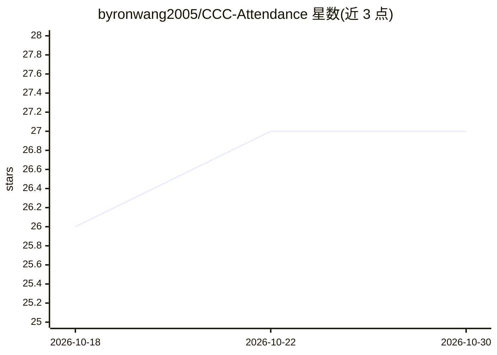

# byronwang2005/CCC-Attendance

⭐ 27 · TypeScript · MIT · 推送 2026-10-22 · [GitHub](https://github.com/byronwang2005/CCC-Attendance) · [官网](https://ccc.byron.wang) · 个人维护 · 中文 README

**UNNC 课程签到码生成工具，项目已失效停用**

面向 UNNC（宁波诺丁汉大学）场景的签到码生成网站，宣传语为“一个签到码，三步搞定”，提供二维码生成趋势与历史累计生成总量统计。README 顶部声明：据社区反馈项目目前已失效，网站仅作纪念保留，并考虑加入留言墙等轻量功能。仓库自述为开源娱乐项目，声明严禁用于代签，采用 MIT 协议开源，接受代码贡献与 Issue 反馈。

## 筛选速览

| 维度 | 判定 | 备注 |
|---|---|---|
| AI 角色 | `ai-enhanced` | 去掉 AI 部分产品仍成立 |
| 许可风险 | `permissive` | MIT |
| 部署形态 | `None` |  |
| 模型依赖 | — | README 未给出锁定关系 |
| 硬件要求 | — | 无带数字的原话,不猜 |
| 安装摩擦 | `low` | 无编译、无系统依赖或容器化 |
| 成熟度 | — | 结构信号不足 |

## 能力要点

- 签到码三步生成流程
- 提供二维码生成趋势与历史累计生成量统计
- 项目已失效，网站保留作纪念
- 声明严禁用于代签并保留追责权利

## 适用场景

- （已失效）了解历史使用情况与生成量统计
- 通过 Issues 或贡献代码参与项目维护

## 场景标签

 · 领域:校园/教务工具

## 证据(README 行号)

> L15: - 本仓库是一个开源娱乐项目，严禁用于CCC代签
> L21: 访问项目网站

## 星数曲线

2026-10-18 26 → 2026-10-30 27（+1）

---
*卡片 v1 · prompt 1.4 · 生成 2026-10-26 · 置信度 low · 依据 README sha `a2273e362e3b` · [字段定义](../../DATASET.md)*
