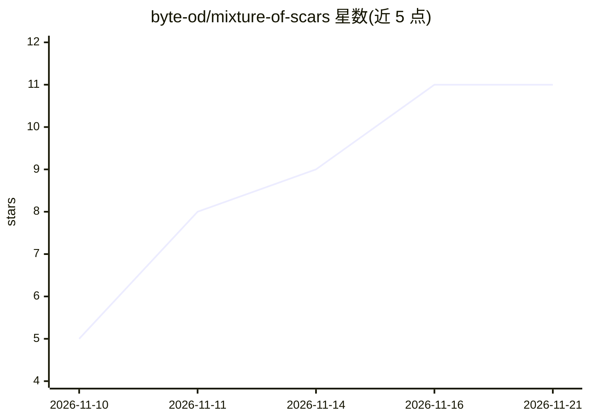

# byte-od/mixture-of-scars

⭐ 11 · Python · MIT · 推送 2026-11-19 · [GitHub](https://github.com/byte-od/mixture-of-scars) · [官网](https://github.com/byte-od/mixture-of-scars) · 个人维护

**面向边缘与科研场景的 LLM 静态压缩与 O(1) KV 缓存库**

包含四个独立 Python 包：scar_native（12 层共享阶段 MoS 语言模型与 3D 生成，含 38 个 WebGPU WGSL 着色器）、scar_codec（零 PyTorch 依赖的 NumPy + C99/SIMD 科学数据压缩编解码器）、scar_cache（对 HuggingFace 模型做 MoS 静态权重压缩与 SCache O(1) KV 缓存替换，0.5B–72.71B）、scar_field（实验性 post-Transformer 引擎，前沿研发阶段）。README 以实证审计表格呈现 A100 训练与 Apple Silicon/边缘 CPU 验证结果，提供 pytest 与基准脚本供复现。

## 筛选速览

| 维度 | 判定 | 备注 |
|---|---|---|
| AI 角色 | `ai-ecosystem` | LLM/agent 周边工具 |
| 许可风险 | `permissive` | MIT |
| 部署形态 | `library` | 以包/库形式分发 |
| 模型依赖 | — | README 未给出锁定关系 |
| 硬件要求 | `gpu-24g` | |
| 安装摩擦 | `medium` | 含编译或系统依赖之一 |
| 成熟度 | — | 结构信号不足 |

## 能力要点

- scar_cache 提供 HuggingFace drop-in 的 SCache O(1) KV 缓存替换，覆盖 0.5B→72.71B MoS
- scar_codec 仅依赖 NumPy，自动编译 C99/SIMD 内核，支持 .scar 容器与 Zarr 编解码
- 38 个 WebGPU WGSL 1.0 着色器，在 Apple Silicon Metal 上验证
- 四个独立 Python 包，覆盖压缩、缓存、原生模型与实验引擎

## 适用场景

- 在低于 24 GB VRAM 的 GPU 上加载与运行 72.71B 压缩模型
- 对天文/航天等科学数据做确定性误差上界的压缩存档
- 在边缘 CPU 设备上运行小体积字节级语言模型

## 场景标签

`模型量化` `推理引擎` · 领域:训练与推理

## 证据(README 行号)

> L16: This repository houses the complete **Scar Operator** research and engineering ecosystem across **four standalone P
> L22: |**`scar_cache/`** (`v4.0`, `mos-run` / `mos-store` / `mos-webgpu`)|Drop-in HuggingFace `SCache O(1)`, `0.5B → 72.7

## 星数曲线

2026-11-10 5 → 2026-11-21 11（+6）

---
*卡片 v1 · prompt 1.4 · 生成 2026-11-18 · 置信度 mid · 依据 README sha `0474f34ce8d1` · [字段定义](../../DATASET.md)*
