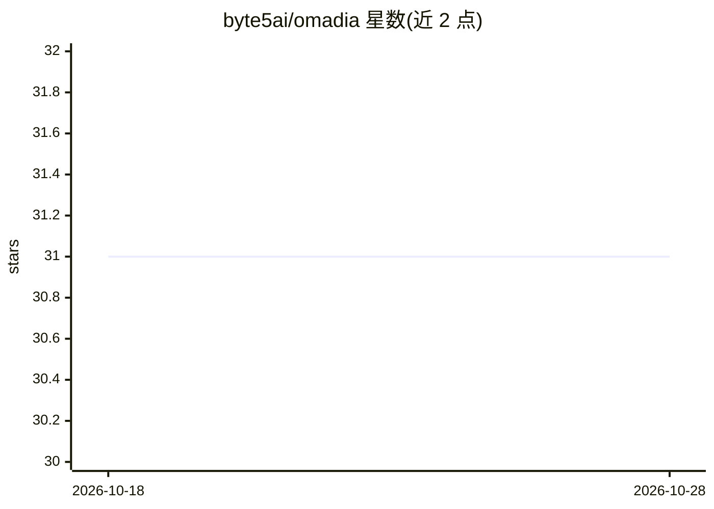

# byte5ai/omadia

⭐ 31 · TypeScript · MIT · 推送 2026-10-28 · [GitHub](https://github.com/byte5ai/omadia) · [官网](https://omadia.ai) · 组织维护

**自托管多智能体 OS：构建、运行与审计 AI agent 团队**

TypeScript 编写的自托管 agentic OS，供团队在自有基础设施上运行多 agent：渠道（Teams/Slack/Telegram 等）将消息交给 orchestrator，由其路由到专家 agent 并调度插件工具；插件通过 @omadia/plugin-api 接入 Microsoft 365、Google Workspace、Odoo 等 30 个数据源。模型请求经 Privacy Shield 脱敏后发送至自选 LLM（Anthropic/OpenAI/Mistral/MiniMax/Ollama）。提供答案核验、哈希链回执、Conductor 工作流与 no-code agent 生成器。一条 docker compose up 命令启动三个容器；public preview 状态，1.0 前 API 与数据库 schema 可能变动。

## 筛选速览

| 维度 | 判定 | 备注 |
|---|---|---|
| AI 角色 | `ai-ecosystem` | LLM/agent 周边工具 |
| 许可风险 | `permissive` | MIT |
| 部署形态 | `self-host` | docker 或自建部署 |
| 模型依赖 | local-ok | 支持本地模型 |
| 硬件要求 | — | 无带数字的原话,不猜 |
| 安装摩擦 | `low` | 无编译、无系统依赖或容器化 |
| 成熟度 | `idea` | |

## 能力要点

- Privacy Shield 在服务端保留原始数据、向模型交付去身份化摘要
- 答案核验：对照来源检查金额/日期/发票号，可拦截被驳斥的回答
- 30 个插件连接 Microsoft 365、Google Workspace、Odoo 等，支持自选 LLM 含本地 Ollama
- 哈希链回执与 call-stack 查看器记录运行过程，可插拔 no-code 生成的 agent

## 适用场景

- 团队在自有服务器上运行多 agent 处理真实业务数据
- 在 Slack/Teams 等渠道中与共享 agent 协作并审计其行为
- 合规要求下让 agent 接触客户数据且数据不出自有基础设施

## 场景标签

`多智能体` `Agent 框架` `聊天机器人` · 领域:Agent 开发

## 证据(README 行号)

> L14: **omadia is a self-hostable, multiplayer agentic OS that makes AI dependable
> L36: - 🔌 **30 plugins in the hub**: Connect Microsoft 365, Google Workspace, Odoo, Confluence, GitHub, Dynamics CRM and 
> L74: Channels hand each turn to the orchestrator, which routes it to specialist

## 星数曲线

2026-10-18 31 → 2026-10-28 31（+0）

---
*卡片 v1 · prompt 1.4 · 生成 2026-10-26 · 置信度 high · 依据 README sha `0e13c7be461f` · [字段定义](../../DATASET.md)*
