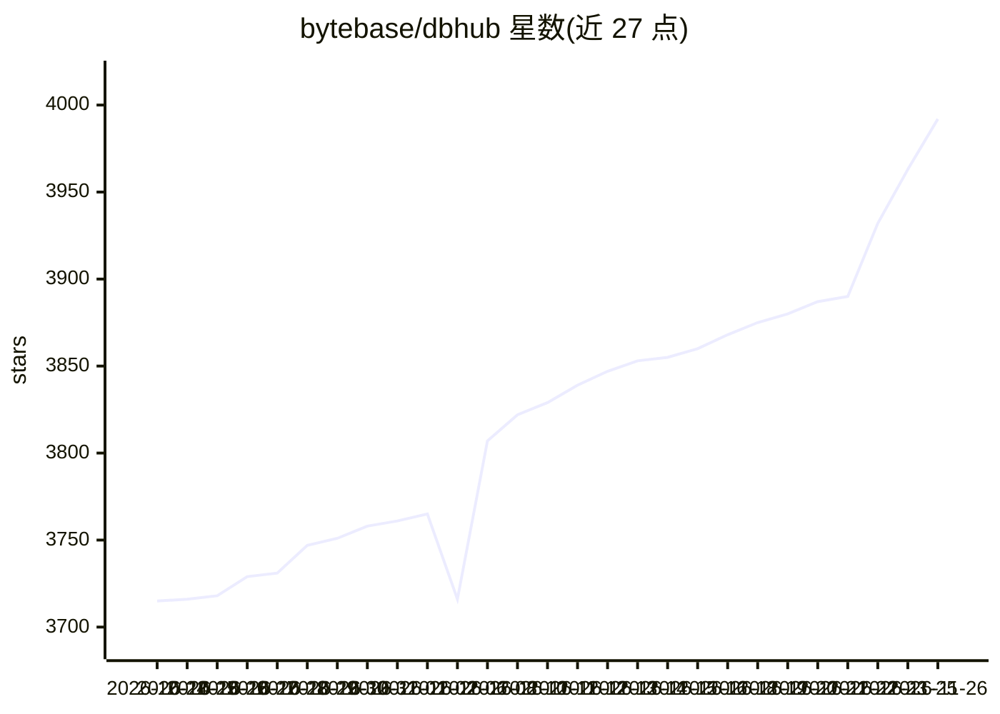

# bytebase/dbhub

⭐ 3,992 · TypeScript · MIT · 推送 2026-11-25 · [GitHub](https://github.com/bytebase/dbhub) · [官网](https://dbhub.ai) · 组织维护

**轻量数据库 MCP 服务器，让 AI 客户端连接查询多种数据库**

DBHub 是一个零依赖的 MCP 服务器，通过单一进程让 MCP 兼容客户端（如 Claude Code、VS Code、Cursor）连接并探索多种数据库，默认仅提供 execute_sql 与 search_objects 两个工具，另有 explain_sql、health_check 等可选工具及自定义 SQL 工具。提供只读模式、行数限制、查询超时等防护，支持 SSH 隧道与 SSL/TLS，可用 npx、Docker 镜像或 MCP Bundle 安装。开发需 Node.js >= 22.5.0。

## 筛选速览

| 维度 | 判定 | 备注 |
|---|---|---|
| AI 角色 | `ai-ecosystem` | LLM/agent 周边工具 |
| 许可风险 | `permissive` | MIT |
| 部署形态 | `library` | 以包/库形式分发 |
| 模型依赖 | — | README 未给出锁定关系 |
| 硬件要求 | — | 无带数字的原话,不猜 |
| 安装摩擦 | `low` | 无编译、无系统依赖或容器化 |
| 成熟度 | — | 结构信号不足 |

## 能力要点

- 默认仅两个 MCP 工具，工具定义共 261 tokens，节省上下文窗口
- 单一接口连接 PostgreSQL、MySQL、MariaDB、SQL Server、Oracle、ClickHouse、SQLite
- 只读模式、行数限制与查询超时防护，支持 SSH 隧道与 SSL/TLS
- 内置 Workbench 网页界面，无需 MCP 客户端即可执行查询

## 适用场景

- 本地开发时用 Claude Code/Cursor 探索表结构与调试数据
- 通过只读视图让非技术同事访问数据
- 用一个进程替代每个数据库各一个 MCP 服务器
- 生产环境只读诊断与故障排查

## 场景标签

`数据分析` · 领域:效率与自动化

## 证据(README 行号)

> L21: DBHub is a minimal MCP server: token-efficient, zero-dependency, and just two tools by default with opt-in extras. 
> L24: - **Multi-Database**: PostgreSQL, MySQL, MariaDB, SQL Server, Oracle, ClickHouse, and SQLite through a single inter

## 星数曲线

2026-10-24 3,715 → 2026-11-26 3,992（+277）

---
*卡片 v1 · prompt 1.4 · 生成 2026-11-26 · 置信度 mid · 依据 README sha `904dd4c9b0f5` · [字段定义](../../DATASET.md)*
