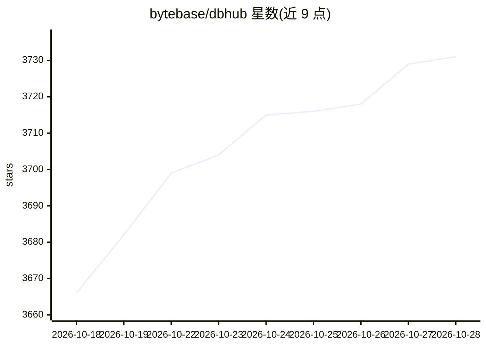

# bytebase/dbhub

⭐ 3,747 · TypeScript · MIT · 推送 2026-10-26 · [GitHub](https://github.com/bytebase/dbhub) · [官网](https://dbhub.ai) · 组织维护

**连接多种数据库的轻量 MCP 服务器，供 MCP 客户端使用**

Bytebase 维护的零依赖 MCP 服务器，通过单一接口让 Claude Desktop、Claude Code、VS Code、Cursor 等 MCP 客户端连接 PostgreSQL、MySQL、SQL Server、Oracle、MariaDB、SQLite，支持多数据库同时连接（TOML 配置）。默认仅加载 2 个工具（execute_sql、search_objects），占 1.4k tokens，另有 explain_sql、health_check 等可选工具。提供只读模式、行数限制、查询超时等防护机制，支持 SSH 隧道与 SSL/TLS。内置 Web 工作台可脱离 MCP 客户端执行查询。README 提及企业级需求可转向 Bytebase。

## 筛选速览

| 维度 | 判定 | 备注 |
|---|---|---|
| AI 角色 | `ai-ecosystem` | LLM/agent 周边工具 |
| 许可风险 | `permissive` | MIT |
| 部署形态 | `library` | 以包/库形式分发 |
| 模型依赖 | — | README 未给出锁定关系 |
| 硬件要求 | — | 无带数字的原话,不猜 |
| 安装摩擦 | `low` | 无编译、无系统依赖或容器化 |
| 成熟度 | — | 结构信号不足 |

## 能力要点

- 零依赖，默认 2 个工具占 1.4k tokens
- 单接口支持 6 种数据库并多库同时连接
- 只读模式、行数限制、查询超时等 guardrails
- 内置 Web Workbench，无需 MCP 客户端即可执行查询

## 适用场景

- 用 Claude Code/Cursor 在本地开发中探索表结构与调试查询
- 以只读视图向非技术人员开放数据库访问
- 用一个进程替代多个单数据库 MCP 服务器

## 场景标签

 · 领域:数据库/LLM 基础设施

## 证据(README 行号)

> L23: DBHub is a minimal MCP server: token-efficient, zero-dependency, and just two tools by default with opt-in extras. 
> L56: DBHub implements MCP tools for database operations:

## 星数曲线

2026-10-18 3,666 → 2026-10-28 3,731（+65）

---
*卡片 v1 · prompt 1.4 · 生成 2026-10-20 · 置信度 high · 依据 README sha `1061bc0ed16b` · [字段定义](../../DATASET.md)*
