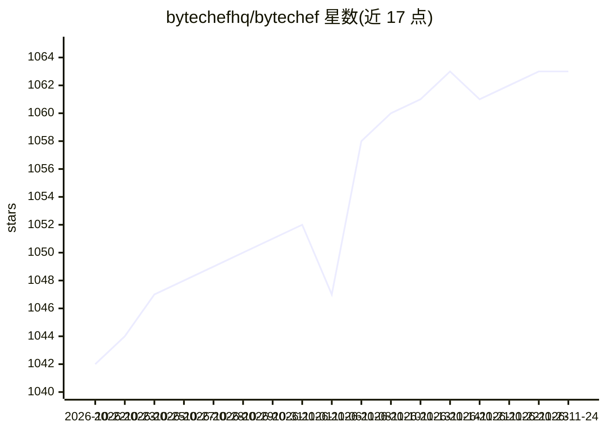

# bytechefhq/bytechef

⭐ 1,065 · Java · NOASSERTION · 推送 2026-11-23 · [GitHub](https://github.com/bytechefhq/bytechef) · [官网](https://www.bytechef.io) · 组织维护

**开源 AI 代理与工作流自动化平台，可自托管或嵌入 SaaS**

以 Java 编写的工作流自动化与 AI Agent 平台：拖拽式可视化编辑器中，AI Agent 作为工作流的一个步骤运行完整代理循环（模型选择工具、执行、观察、下一步），支持流式与结构化输出。核心机制包括基于 Atlas 运行时的持久化执行（失败或暂停的任务可从断点恢复）、250+ 连接器（每个同时是代理工具与 MCP 工具）、12 个 LLM 提供商接入、14 种向量存储与 RAG 组件、12 种护栏。核心为 Apache 2.0，嵌入版 iPaaS、Git 原生、AI Copilot 等属企业版。通过 Docker 或 Docker Compose 一键启动。

## 筛选速览

| 维度 | 判定 | 备注 |
|---|---|---|
| AI 角色 | `ai-ecosystem` | LLM/agent 周边工具 |
| 许可风险 | `permissive` | NOASSERTION |
| 部署形态 | `self-host` | docker 或自建部署 |
| 模型依赖 | local-ok | 支持本地模型 |
| 硬件要求 | — | 无带数字的原话,不猜 |
| 安装摩擦 | `low` | 无编译、无系统依赖或容器化 |
| 成熟度 | — | 结构信号不足 |

## 能力要点

- AI Agent 作为工作流步骤，配合持久化执行实现中途断点恢复
- 250+ 连接器同时充当代理工具与 MCP 工具，支持双向 MCP
- 12 个 LLM 提供商 + 4 个聚合网关组件，支持本地 Ollama
- 14 种向量存储与 8 种聊天记忆后端，RAG 组件内置

## 适用场景

- 自托管平台把 AI 代理编排进自动化工作流
- 把集成与 AI 代理嵌入到自己的 SaaS 产品中
- 用 250+ 连接器编排 CRM、营销、电商等业务流程
- 把内部工作流暴露为 MCP 工具供 Claude Desktop、Cursor 调用

## 场景标签

`工作流自动化` · 领域:效率与自动化

## 证据(README 行号)

> L9: # **Open-source AI agents and workflow automation**
> L24: A drag-and-drop **AI Agent** component runs the full agent loop: model, tool selection, execution, observation, nex
> L127: - **Durable execution and orchestration** on the Atlas runtime: every task execution is persisted in Postgres, so 

## 星数曲线

2026-10-22 1,042 → 2026-11-24 1,063（+21）

---
*卡片 v1 · prompt 1.4 · 生成 2026-11-24 · 置信度 high · 依据 README sha `dc5ae7bc3b64` · [字段定义](../../DATASET.md)*
