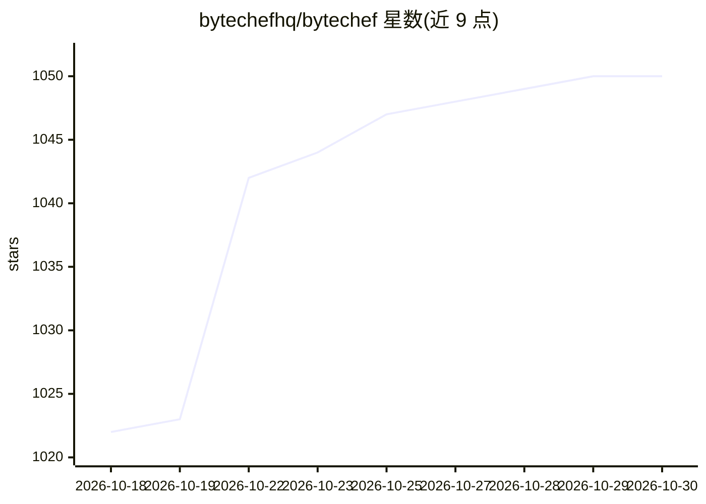

# bytechefhq/bytechef

⭐ 1,050 · Java · NOASSERTION · 推送 2026-10-29 · [GitHub](https://github.com/bytechefhq/bytechef) · [官网](https://www.bytechef.io) · 组织维护

**开源 AI agent 与工作流自动化平台，可自托管或嵌入 SaaS**

基于 Java 的低代码工作流自动化平台：拖拽式 AI Agent 组件运行完整 agent 循环（模型、工具选择、执行、观察、下一步），agent 是持久化工作流中的一个步骤，失败的运行可从该步骤恢复。提供 250+ 连接器（同时可作为 agent 工具和 MCP 工具）、12 个直连 LLM 提供商、8 种记忆后端、14 种向量库、12 种护栏，支持双向 MCP。核心 Apache 2.0，另有 EE 版（Workflows-as-APIs、Git-native、AI Copilot、嵌入式 iPaaS 等）。通过 Docker/Docker Compose 部署，面向开发团队与 SaaS 厂商。

## 筛选速览

| 维度 | 判定 | 备注 |
|---|---|---|
| AI 角色 | `ai-ecosystem` | LLM/agent 周边工具 |
| 许可风险 | `permissive` | NOASSERTION |
| 部署形态 | `self-host` | docker 或自建部署 |
| 模型依赖 | local-ok | 支持本地模型 |
| 硬件要求 | — | 无带数字的原话,不猜 |
| 安装摩擦 | `low` | 无编译、无系统依赖或容器化 |
| 成熟度 | — | 结构信号不足 |

## 能力要点

- AI Agent 作为持久化工作流步骤，mid-run 可恢复执行
- 250+ 连接器，每个连接器同时是 agent 工具和 MCP 工具
- 12 个直连 LLM 提供商 + 3 个聚合路由组件
- 8 种记忆后端、14 种向量库、12 种护栏，双向 MCP 支持

## 适用场景

- 搭建带工具调用和人工审批节点的 AI agent 工作流
- 为自己的 SaaS 产品嵌入集成与 AI agent 能力（嵌入式 iPaaS）
- 将现有工作流发布为 MCP 工具供 Claude Desktop、Cursor 等调用

## 场景标签

`工作流自动化` `Agent 框架` · 领域:Agent 开发

## 证据(README 行号)

> L24: A drag-and-drop **AI Agent** component runs the full agent loop: model, tool selection, execution, observation, nex
> L133: - **Agents inside workflows:** an agent is a step; downstream branches react to its decisions
> L147: |Capability|CE (Apache 2.0)|EE|

## 星数曲线

2026-10-18 1,022 → 2026-10-30 1,050（+28）

---
*卡片 v1 · prompt 1.4 · 生成 2026-10-21 · 置信度 high · 依据 README sha `116e25c3d3d7` · [字段定义](../../DATASET.md)*
