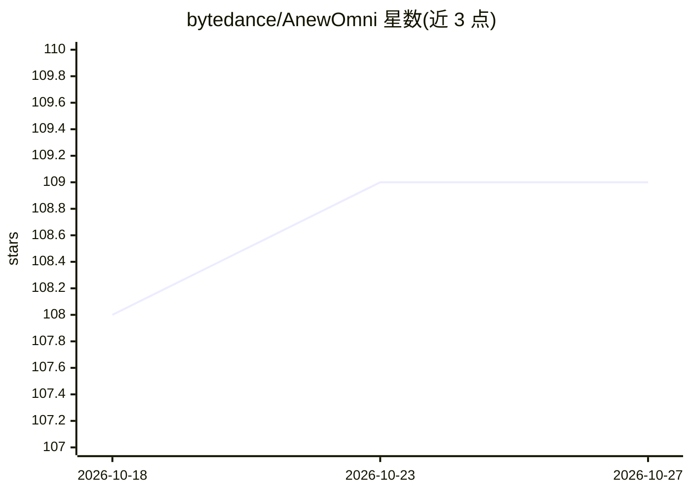

# bytedance/AnewOmni

⭐ 109 · Python · MIT · 推送 2026-06-06 · [GitHub](https://github.com/bytedance/AnewOmni) · [官网](https://www.biorxiv.org/content/10.64898/2026.03.12.711044) · 组织维护

**全原子生成模型：面向靶蛋白设计与生成分子/多肽/抗体结合物**

论文 "Programming Biomolecular Interactions with All-Atom Generative Model" 的官方代码库。基于隐空间扩散模型，针对给定靶蛋白结构生成小分子、分子生长/连接、共价分子、线性/环肽、抗体 CDR 等多类 binder。提供配置驱动 CLI、从头抗体设计流水线（可选 protenix/boltz2 作为共折叠后端）及本地交互式 Web UI（提示语言编程、结果 2D/3D 检查）。需 conda 环境（CUDA 12.4 + PyTorch 2.5.1）与从 GitHub release 下载模型权重。

## 筛选速览

| 维度 | 判定 | 备注 |
|---|---|---|
| AI 角色 | `ai-native` | 本体是模型或模型工具 |
| 许可风险 | `permissive` | MIT |
| 部署形态 | `None` |  |
| 模型依赖 | — | README 未给出锁定关系 |
| 硬件要求 | — | 无带数字的原话,不猜 |
| 安装摩擦 | `medium` | 含编译或系统依赖之一 |
| 成熟度 | `idea` | |

## 能力要点

- 统一入口支持小分子、分子补全、共价分子、线性/环肽、抗体 CDR 等多种 binder 生成
- 从头抗体/纳米抗体设计流水线，默认以 protenix 为共折叠后端
- 本地交互式 UI：提示语言编程、任务提交、2D SVG 与 Mol* 3D 结果检查
- 结合位点可通过参考 binder 自动选取（10 Å 内残基）或手动指定 hotspots

## 适用场景

- 给定靶蛋白 PDB 结构，生成可结合的小分子或环肽先导物
- 固定种子片段做分子生长或 linker 连接的定向设计
- 在抗体框架上设计指定长度与类型的 CDR 序列
- 通过浏览器 UI 原型化提示并交互式迭代生成约束

## 场景标签

 · 领域:AI 药物发现/计算生物

## 证据(README 行号)

> L51: python -m api.generate_with_rank --config /path/to/config.yaml --save_dir /path/for/output
> L218: @article{kong2026programming,

## 星数曲线

2026-10-18 108 → 2026-10-27 109（+1）

---
*卡片 v1 · prompt 1.4 · 生成 2026-10-23 · 置信度 high · 依据 README sha `5456ff69fba0` · [字段定义](../../DATASET.md)*
