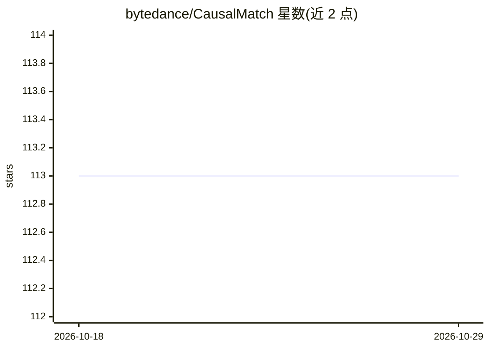

# bytedance/CausalMatch

⭐ 113 · Jupyter Notebook · Apache-2.0 · 推送 2026-03-17 · [GitHub](https://github.com/bytedance/CausalMatch) · 组织维护 · 中文 README

**估计观测数据平均处理效应的 Python 匹配库（PSM/CEM）**

字节跳动数据科学研究项目产出的 Python 包，实现倾向得分匹配（PSM）与粗化精确匹配（CEM）两类经典匹配方法，用于从观测数据估计平均处理效应。倾向得分模型可接入 sklearn 等多种机器学习分类器，提供统一 API，并可基于 f1 分数在多个打分模型间选择。当前版本 v0.0.7，通过 pip 从 PyPI 安装，参考文献覆盖广义随机森林与双重机器学习等因果推断方法。

## 筛选速览

| 维度 | 判定 | 备注 |
|---|---|---|
| AI 角色 | `ai-native` | 本体是模型或模型工具 |
| 许可风险 | `permissive` | Apache-2.0 |
| 部署形态 | `library` | 以包/库形式分发 |
| 模型依赖 | — | README 未给出锁定关系 |
| 硬件要求 | — | 无带数字的原话,不猜 |
| 安装摩擦 | `low` | 无编译、无系统依赖或容器化 |
| 成熟度 | — | 结构信号不足 |

## 能力要点

- 实现倾向得分匹配（PSM）与粗化精确匹配（CEM）
- 倾向得分模型灵活选用多种机器学习分类器，保留因果解释与置信区间
- 统一 API，基于标准 Python 机器学习/数据分析包构建

## 适用场景

- 从观测数据估计处理效应前先做样本匹配
- 尝试多个倾向得分模型并按 f1 分数选择
- 自定义分箱执行粗化精确匹配

## 场景标签

 · 领域:因果推断/计量经济学

## 证据(README 行号)

> L10: **CausalMatch** is a Python package that implements two classic matching methods, propensity score matching (PSM) a
> L11: This package was designed and built as part of the ByteDance data science research program with the goal of combini
> L14: * Maintain flexibility in modeling the propensity score model (via various machine learning classification models),

## 星数曲线

2026-10-18 113 → 2026-10-29 113（+0）

---
*卡片 v1 · prompt 1.4 · 生成 2026-10-23 · 置信度 high · 依据 README sha `fe4921aa3e9f` · [字段定义](../../DATASET.md)*
