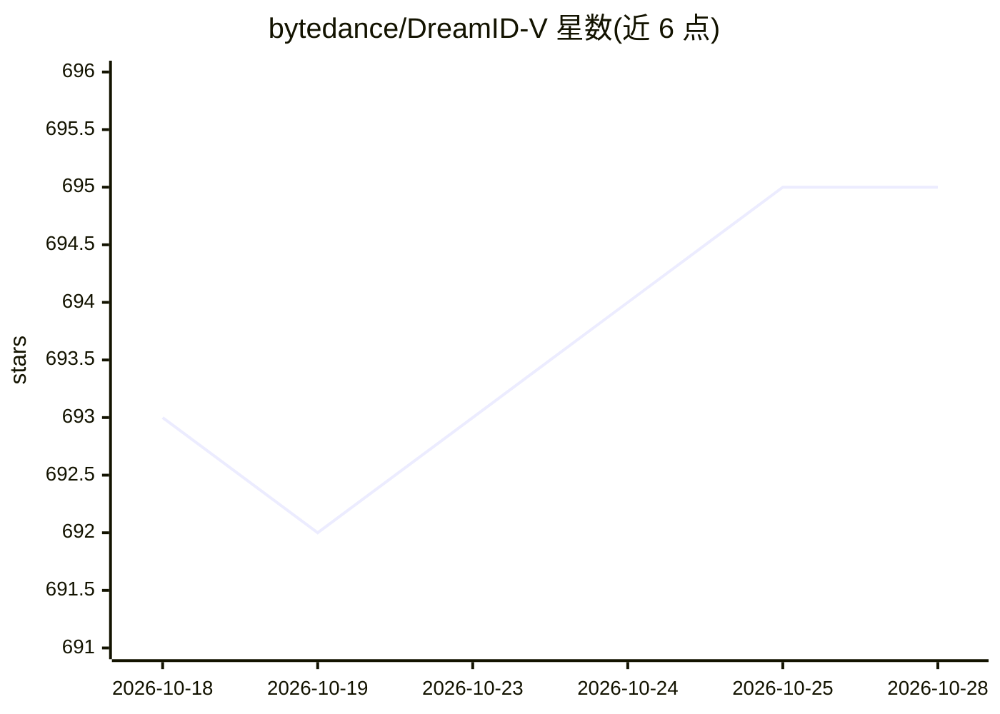

# bytedance/DreamID-V

⭐ 695 · Python · Apache-2.0 · 推送 2026-05-22 · [GitHub](https://github.com/bytedance/DreamID-V) · 组织维护 · 中文 README

**基于扩散 Transformer 的视频人脸替换模型，供研究使用**

ECCV 2026 Oral 论文的官方开源实现：给定 512x512 裁剪人脸参考图，在视频中做高保真人脸替换，基于 Wan-2.1 扩散模型。提供 Faster（更低显存、提速）、DWPose（姿态检测更稳）、MediaPipe 三个变体，支持单卡与多卡（FSDP + xDiT USP）推理，模型权重发布于 Hugging Face。声明仅限学术研究与演示用途，要求标注 AI 生成内容。由清华大学与字节跳动智能创作团队维护。

## 筛选速览

| 维度 | 判定 | 备注 |
|---|---|---|
| AI 角色 | `ai-native` | 本体是模型或模型工具 |
| 许可风险 | `permissive` | Apache-2.0 |
| 部署形态 | `library` | 以包/库形式分发 |
| 模型依赖 | — | README 未给出锁定关系 |
| 硬件要求 | `gpu-8g` | |
| 安装摩擦 | `low` | 无编译、无系统依赖或容器化 |
| 成熟度 | — | 结构信号不足 |

## 能力要点

- 图像到视频的人脸替换，基于 Wan-2.1 扩散 Transformer
- 提供 Faster/DWPose/MediaPipe 三个推理变体
- 支持单卡与多卡推理（FSDP + xDiT USP）
- 模型与 IDBench 基准发布于 Hugging Face

## 适用场景

- 学术研究中做视频人脸替换实验
- 复现论文结果或进行视频身份编辑研究
- 结合 ComfyUI 工作流使用社区适配版本

## 场景标签

`图像视频处理` · 领域:感知与多模态

## 证据(README 行号)

> L9: > **DreamID-V: Bridging the Image-to-Video Gap for High-Fidelity Face Swapping via Diffusion Transformer**
> L59: python generate_dreamidv_faster.py \

## 星数曲线

2026-10-18 693 → 2026-10-28 695（+2）

---
*卡片 v1 · prompt 1.4 · 生成 2026-10-21 · 置信度 high · 依据 README sha `edf0740a6470` · [字段定义](../../DATASET.md)*
