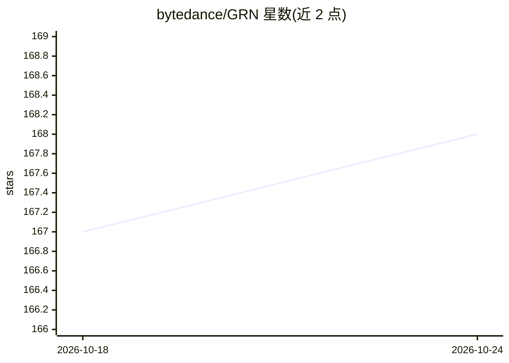

# bytedance/GRN

⭐ 168 · Python · MIT · 推送 2026-10-14 · [GitHub](https://github.com/bytedance/GRN) · [官网](https://bytedance.github.io/GRN/) · 组织维护 · 中文 README

**视觉生成新范式 GRN 官方实现：文生图/类生图/文生视频/图生视频**

ECCV 2026 论文 Generative Refinement Networks 的官方 PyTorch 实现。GRN 提出扩散与自回归之外的生成范式：用 HBQ 分层二值量化做近无损 token 化、全局逐步细化机制、熵引导采样按复杂度自适应生成。面向视觉生成研究者与开发者，提供 HBQ tokenizer、C2I/T2I/T2V/I2V 的训练与推理代码、模型权重（含覆盖三任务的 8B 统一模型）和 Hugging Face T2I 在线 Demo。训练建议 8x80GB GPU 以上，通过 conda 环境与源码方式安装运行。

## 筛选速览

| 维度 | 判定 | 备注 |
|---|---|---|
| AI 角色 | `ai-native` | 本体是模型或模型工具 |
| 许可风险 | `permissive` | MIT |
| 部署形态 | `library` | 以包/库形式分发 |
| 模型依赖 | — | README 未给出锁定关系 |
| 硬件要求 | `gpu-24g` | |
| 安装摩擦 | `medium` | 含编译或系统依赖之一 |
| 成熟度 | — | 结构信号不足 |

## 能力要点

- HBQ 分层二值量化实现近无损 token 化
- 全局细化机制与熵引导的自适应步数采样
- GRN-8B 单一模型覆盖 T2V、I2V、T2I
- 提供 tokenizer 与 C2I/T2I/T2V 的训练、微调、评测脚本

## 适用场景

- 研究并复现 GRN 视觉生成范式
- 训练或微调自己的文生图/文生视频模型
- 在浏览器 Hugging Face Demo 直接体验文生图

## 场景标签

`图像生成` `视频生成` `模型训练` · 领域:内容生成

## 证据(README 行号)

> L24: This is the official implementation of the paper **Generative Refinement Networks for Visual Synthesis**. Neither d
> L28: We introduce **Generative Refinement Networks (GRN)**, a new visual synthesis paradigm that addresses these issues:
> L33: GRN achieves state-of-the-art results on ImageNet reconstruction and class-conditional generation, and scales effec

## 星数曲线

2026-10-18 167 → 2026-10-24 168（+1）

---
*卡片 v1 · prompt 1.4 · 生成 2026-10-22 · 置信度 high · 依据 README sha `8587d714b803` · [字段定义](../../DATASET.md)*
