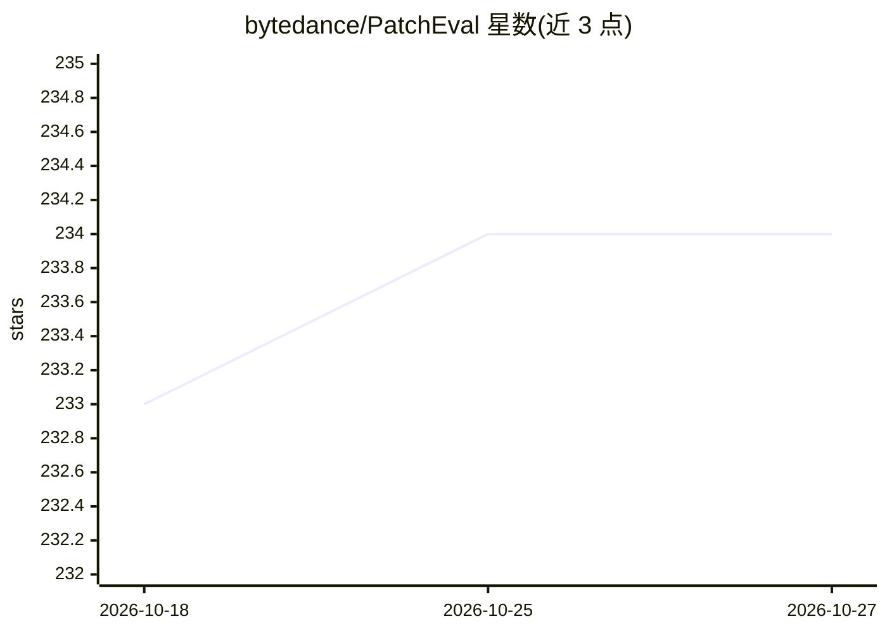

# bytedance/PatchEval

⭐ 234 · Python · Apache-2.0 · 推送 2026-10-19 · [GitHub](https://github.com/bytedance/PatchEval) · [官网](https://patcheval.github.io/) · 组织维护 · 中文 README

**评测 LLM/Agent 修复真实漏洞能力的基准（230 个 CVE）**

字节跳动发布的漏洞修复基准 PatchEval-Verified：收录 2015-2025 年 Go/JavaScript/Python 的 230 个 CVE 案例，每个案例提供含漏洞仓库与验证入口的 Docker 镜像。工作流分两阶段：先用 CLI 编码 agent（Codex/OpenCode/TraeCLI 适配器）生成补丁，再在 Docker 环境中通过强化 PoC 测试验证漏洞是否被修复；也支持独立评估外部系统生成的补丁。要求 Linux、Docker、Python 3.10+，全量镜像需约 500GB 磁盘。

## 筛选速览

| 维度 | 判定 | 备注 |
|---|---|---|
| AI 角色 | `ai-knowledge` | 知识聚合/清单类 |
| 许可风险 | `permissive` | Apache-2.0 |
| 部署形态 | `library` | 以包/库形式分发 |
| 模型依赖 | — | README 未给出锁定关系 |
| 硬件要求 | — | 无带数字的原话,不猜 |
| 安装摩擦 | `low` | 无编译、无系统依赖或容器化 |
| 成熟度 | — | 结构信号不足 |

## 能力要点

- 230 个 CVE 案例各配 Docker 评估环境与验证入口
- 两阶段工作流：agent 生成补丁 → Docker 环境中验证
- 内置 Codex CLI、OpenCode、TraeCLI 三种 agent 适配器
- 支持独立评估外部系统生成的补丁（JSON/JSONL 输入）

## 适用场景

- 评测编码 agent 在真实漏洞修复任务上的表现
- 对比不同模型/agent 的漏洞修复通过率
- 验证外部补丁生成系统产出的补丁是否真正修复漏洞

## 场景标签

`模型评测` `网络安全` · 领域:评测与运维

## 证据(README 行号)

> L21: * **[2025/11/18]** PatchEval is released as a benchmark for evaluating Large Language Models and agents on real-wor
> L39: **PatchEval-Verified** evaluates LLMs and coding agents on automated repair of real-world vulnerabilities. This rep

## 星数曲线

2026-10-18 233 → 2026-10-27 234（+1）

---
*卡片 v1 · prompt 1.4 · 生成 2026-10-22 · 置信度 mid · 依据 README sha `16408b247bb2` · [字段定义](../../DATASET.md)*
