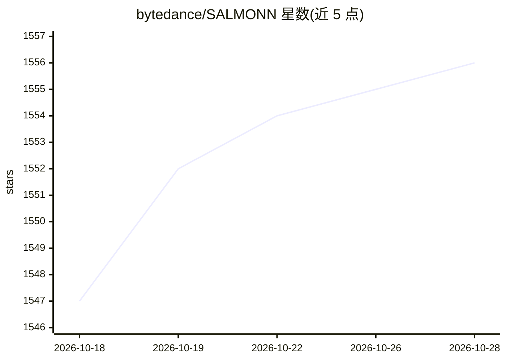

# bytedance/SALMONN

⭐ 1,556 · Apache-2.0 · 推送 2026-10-16 · [GitHub](https://github.com/bytedance/SALMONN) · [官网](https://bytedance.github.io/SALMONN/) · 组织维护 · 中文 README

**多模态大语言模型家族：语音/音频/视频理解与生成**

字节跳动发布的 SALMONN 多模态大模型家族仓库，以分支形式组织系列模型：包括 ICLR 2024 的 SALMONN（语音音频到文本）、video-SALMONN 及其 o1/2 版本（视频理解）、ELLSA（流式全双工统一视觉、语音、文本与动作）、语音质量评估版本及 QualiSpeech 数据集。发布内容覆盖模型 checkpoint、推理代码、训练代码与 3 阶段训练标注数据（600k SQA/AQA 与 50k 讲故事数据）。各模型均对应发表论文（ICLR/ICML/ACL 等）。README 主页为索引页，具体安装运行方式在各分支。

## 筛选速览

| 维度 | 判定 | 备注 |
|---|---|---|
| AI 角色 | `ai-native` | 本体是模型或模型工具 |
| 许可风险 | `permissive` | Apache-2.0 |
| 部署形态 | `None` |  |
| 模型依赖 | — | README 未给出锁定关系 |
| 硬件要求 | — | 无带数字的原话,不猜 |
| 安装摩擦 | `low` | 无编译、无系统依赖或容器化 |
| 成熟度 | — | 结构信号不足 |

## 能力要点

- 按分支组织多个多模态大模型（SALMONN/video-SALMONN/ELLSA 等）
- ELLSA：流式全双工统一视觉、语音、文本与动作的端到端模型
- 公开训练代码、模型 checkpoint 与 600k SQA/AQA 标注数据
- 附带 QualiSpeech 自然语言推理语音质量评估数据集

## 适用场景

- 研究者复现或基于 checkpoint 做语音/音频/视频多模态理解
- 训练自己的音频 LLM 或做语音质量评估
- 做多模态大模型的对比实验基准

## 场景标签

`多模态` `模型训练` · 领域:感知与多模态

## 证据(README 行号)

> L9: The SALMONN model family consists of a series of advanced multi-modal large language models. For more details, pleas
> L22: - [2026-04-20] We have released the model and inference code for **ELLSA**! See here! ELLSA is the first end-to-end
> L23: - [2025-07-08] We have opensourced **video-SALMONN 2**! video-SALMONN 2 is a powerful audio-visual LLM that generat

## 星数曲线

2026-10-18 1,547 → 2026-10-28 1,556（+9）

---
*卡片 v1 · prompt 1.4 · 生成 2026-10-21 · 置信度 mid · 依据 README sha `61f586bbcd89` · [字段定义](../../DATASET.md)*
