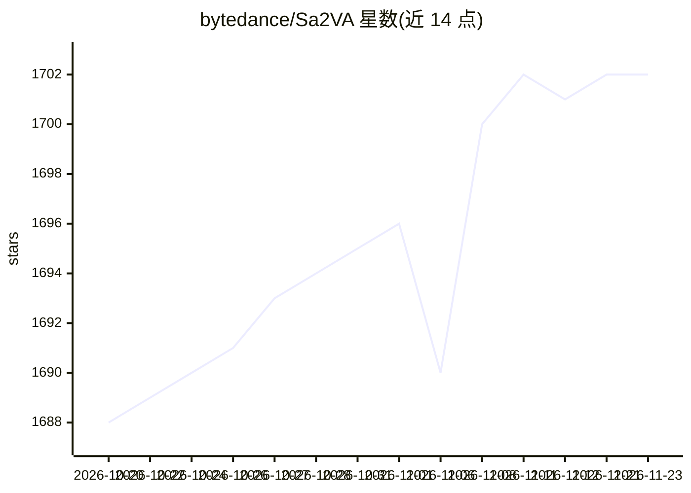

# bytedance/Sa2VA

⭐ 1,702 · Python · Apache-2.0 · 推送 2026-10-30 · [GitHub](https://github.com/bytedance/Sa2VA) · 组织维护

**像素级多模态大模型研究代码库，供视觉理解开发者使用**

Pixel LLMs 项目家族的官方代码库，核心模型 Sa2VA 将 SAM-2 与多模态 LLM 结合，支持指代分割、视觉提示、图像/视频对话等任务，可选 InternVL2.5/3 与 Qwen2.5-VL/Qwen3-VL 骨干。附带 VRT 视觉推理追踪（含 VRT-Bench 评测集与 VRT-80k 训练数据）、SAMTok 掩码词元接口及 SaSaSa2VA、Pixel-SAIL 扩展。依赖用 uv 管理，经 setup_env.sh 或 uv sync 配置环境后进行训练与评测。

## 筛选速览

| 维度 | 判定 | 备注 |
|---|---|---|
| AI 角色 | `ai-native` | 本体是模型或模型工具 |
| 许可风险 | `permissive` | Apache-2.0 |
| 部署形态 | `library` | 以包/库形式分发 |
| 模型依赖 | — | README 未给出锁定关系 |
| 硬件要求 | — | 无带数字的原话,不猜 |
| 安装摩擦 | `low` | 无编译、无系统依赖或容器化 |
| 成熟度 | — | 结构信号不足 |

## 能力要点

- Sa2VA 统一模型支持指代分割、grounded 对话、图像/视频聊天
- 支持 InternVL2.5/3 与 Qwen2.5-VL/Qwen3-VL 骨干
- 提供 VRT-Bench 评测基准与 VRT-80k 训练数据
- uv 锁定依赖实现跨机器可复现环境

## 适用场景

- 训练或评测视频指代分割与 grounded 理解模型
- 在自研 MLLM 中接入掩码词元接口生成/理解掩码
- 基于 Sa2VA 构建目标级视觉推理扩展

## 场景标签

`模型评测` `多模态` · 领域:评测与运维

## 证据(README 行号)

> L3: **Pixel LLMs** is a family of projects that bring pixel-level, dense grounded understanding to multimodal LLMs. It i
> L16: The core unified model: SAM-2 + MLLM for referring segmentation, grounded conversation, visual prompting, and image

## 星数曲线

2026-10-20 1,688 → 2026-11-23 1,702（+14）

---
*卡片 v1 · prompt 1.4 · 生成 2026-11-23 · 置信度 mid · 依据 README sha `69917c7f5a1a` · [字段定义](../../DATASET.md)*
