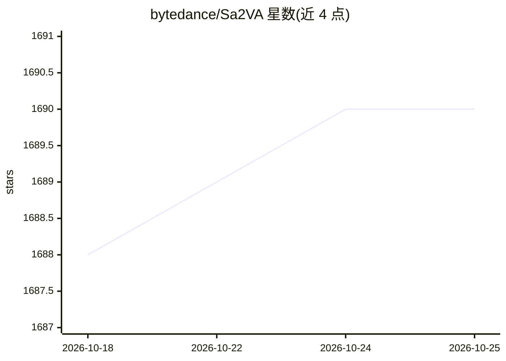

# bytedance/Sa2VA

⭐ 1,691 · Python · Apache-2.0 · 推送 2026-09-08 · [GitHub](https://github.com/bytedance/Sa2VA) · 组织维护

**像素级接地多模态大模型家族：SAM-2 与 MLLM 结合的图像视频分割理解**

字节跳动维护的 Pixel LLMs 代码库，核心是 Sa2VA：将 SAM-2 与多模态大模型结合，支持指代分割、接地对话、视觉提示与图像/视频聊天，可选 InternVL2.5/3 与 Qwen2.5-VL/Qwen3-VL 骨干。家族还包括 VRT（目标级接地推理，附评测基准与训练数据）、SAMTok（两词表示任意掩码的统一接口）、SaSaSa2VA（ICCV 2025 LSVOS RVOS 赛道第一名）与 Pixel-SAIL 扩展。依赖用 uv 管理，提供 setup_env.sh 脚本统一环境。

## 筛选速览

| 维度 | 判定 | 备注 |
|---|---|---|
| AI 角色 | `ai-native` | 本体是模型或模型工具 |
| 许可风险 | `permissive` | Apache-2.0 |
| 部署形态 | `library` | 以包/库形式分发 |
| 模型依赖 | — | README 未给出锁定关系 |
| 硬件要求 | — | 无带数字的原话,不猜 |
| 安装摩擦 | `low` | 无编译、无系统依赖或容器化 |
| 成熟度 | — | 结构信号不足 |

## 能力要点

- Sa2VA：SAM-2 + MLLM，支持指代分割/接地对话/视觉提示/图像视频对话
- 支持 InternVL2.5/3 与 Qwen2.5-VL/Qwen3-VL 骨干
- VRT 附带 VRT-Bench 评测基准与 VRT-80k 训练数据
- SaSaSa2VA 获 ICCV 2025 LSVOS Challenge RVOS 赛道第一名

## 适用场景

- 对图像和视频做像素级指代分割与接地对话
- 在多模态大模型研究项目中复现或扩展 Sa2VA
- 使用 VRT-Bench 评测目标级视觉推理能力

## 场景标签

`多模态` `目标检测` · 领域:感知与多模态

## 证据(README 行号)

> L3: **Pixel LLMs** is a family of projects that bring pixel-level, dense grounded understanding to multimodal LLMs. It i
> L16: The core unified model: SAM-2 + MLLM for referring segmentation, grounded conversation, visual prompting, and image

## 星数曲线

2026-10-18 1,688 → 2026-10-25 1,690（+2）

---
*卡片 v1 · prompt 1.4 · 生成 2026-10-21 · 置信度 mid · 依据 README sha `e3cdb2e2547c` · [字段定义](../../DATASET.md)*
