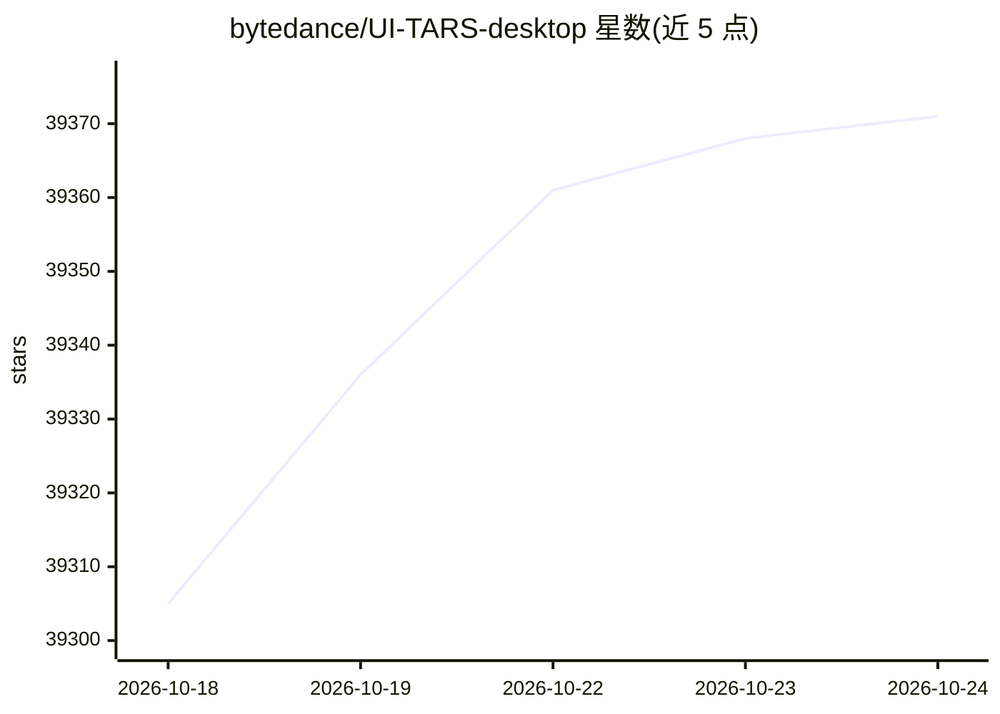

# bytedance/UI-TARS-desktop

⭐ 39,371 · TypeScript · Apache-2.0 · 推送 2026-10-09 · [GitHub](https://github.com/bytedance/UI-TARS-desktop) · [官网](https://agent-tars.com) · 组织维护 · 中文 README

**开发者的多模态 GUI Agent 栈：用自然语言操作电脑与浏览器**

包含两个子项目：Agent TARS 是通用多模态 AI Agent 栈，提供 CLI 与 Web UI，通过多模态 LLM 与 MCP 工具集成，在终端、计算机、浏览器中执行类人任务流程；UI-TARS Desktop 是基于 UI-TARS 模型的桌面应用，提供本地/远程计算机与浏览器操作器，支持截图视觉识别、精确鼠标键盘控制，声称处理全在本地完成。面向使用自然语言驱动 GUI 自动化的开发者与用户，Apache 2.0 协议开源。

## 筛选速览

| 维度 | 判定 | 备注 |
|---|---|---|
| AI 角色 | `ai-native` | 本体是模型或模型工具 |
| 许可风险 | `permissive` | Apache-2.0 |
| 部署形态 | `library` | 以包/库形式分发 |
| 模型依赖 | — | README 未给出锁定关系 |
| 硬件要求 | — | 无带数字的原话,不猜 |
| 安装摩擦 | `low` | 无编译、无系统依赖或容器化 |
| 成熟度 | — | 结构信号不足 |

## 动量与使用信号

- 维护:`active` — 距上次 push 9.3 天,年发版 2,49 位贡献者
- 涨星:近 1 天 **+14**(自 20261016 起算)
- 下载:GitHub Release 附件 累计 384,974(39 个 release)
- 平台:WEB · 协议:MCP

## 能力要点

- Agent TARS CLI 支持 headful Web UI 与 headless 服务器两种执行模式
- 混合浏览器 Agent：GUI Agent、DOM 或混合策略控制浏览器
- 内核基于 MCP 构建，支持挂载 MCP Server 连接真实工具
- UI-TARS Desktop 支持本地与远程计算机/浏览器操作器，跨平台（Windows/macOS/Browser）

## 适用场景

- 用自然语言让 Agent 代为完成订机票、订酒店等浏览器操作任务
- 通过 GUI 自动化操作本地桌面应用（如修改 VS Code 设置）
- 挂载 MCP Server 扩展 Agent 可调用的真实世界工具

## 场景标签

`GUI 自动化` `浏览器自动化` · 领域:效率与自动化

## 证据(README 行号)

> L7:  TARS \* is a Multimodal AI Agent stack, currently shipping two projects: Agent TARS and UI-TARS-desktop:
> L16:  Agent TARS is a general multimodal AI Agent stack, it brings the power of GUI Agent and Vision into your terminal,
> L21:  UI-TARS Desktop is a desktop application that provides a native GUI Agent based on the UI-TARS model.

## 星数曲线

2026-10-18 39,305 → 2026-10-24 39,371（+66）

---
*卡片 v1 · prompt 1.4 · 生成 2026-10-18 · 置信度 high · 依据 README sha `f6fd363370f2` · [字段定义](../../DATASET.md)*
