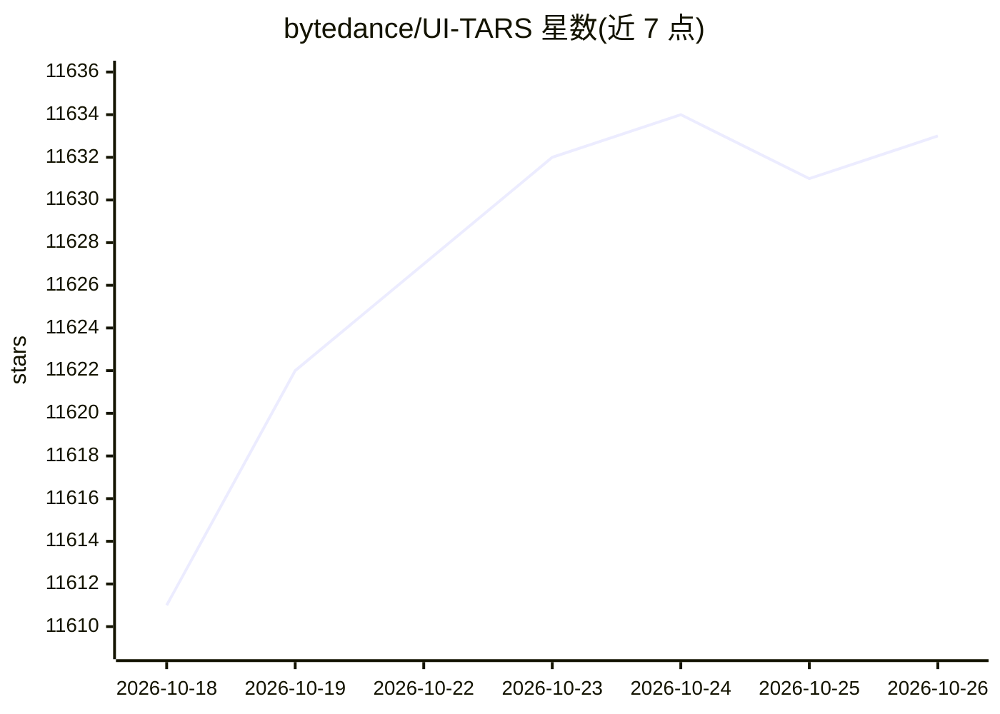

# bytedance/UI-TARS

⭐ 11,633 · Python · Apache-2.0 · 推送 2026-01-27 · [GitHub](https://github.com/bytedance/UI-TARS) · 组织维护 · 中文 README

**字节跳动的开源 GUI 自动操作多模态 agent 模型**

UI-TARS 是基于视觉-语言模型的多模态 agent，通过截图理解与推理执行桌面、移动端 GUI 任务及游戏操作。模型经强化学习训练，可在行动前生成 Thought 推理；提供 COMPUTER_USE/MOBILE_USE/GROUNDING 三种提示模板。使用流程为：经 Hugging Face endpoint 部署模型推理，再用 pip 安装 ui-tars 包做预测后处理，把模型输出解析为 pyautogui 代码。开源 UI-TARS-1.5-7B，完整版仅限研究合作申请。README 声明局限性：需要大量计算资源、可能产生幻觉、存在被滥用于绕过验证码的风险。另有桌面版仓库 UI-TARS-desktop 与网页自动化项目 Midscene.js 关联。

## 筛选速览

| 维度 | 判定 | 备注 |
|---|---|---|
| AI 角色 | `ai-native` | 本体是模型或模型工具 |
| 许可风险 | `permissive` | Apache-2.0 |
| 部署形态 | `library` | 以包/库形式分发 |
| 模型依赖 | — | README 未给出锁定关系 |
| 硬件要求 | — | 无带数字的原话,不猜 |
| 安装摩擦 | `low` | 无编译、无系统依赖或容器化 |
| 成熟度 | `idea` | |

## 能力要点

- 支持桌面（Windows/Linux/macOS）、移动端与 Android 模拟器的 GUI 操作模板
- Thought 推理机制：行动前先推理（强化学习训练）
- pip 安装的 ui-tars 包将模型输出解析为 pyautogui 可执行代码
- 开源 UI-TARS-1.5-7B 模型，更强版本按研究合作方式提供

## 适用场景

- 研究者复现在 OSWorld、Android World 等基准上的 GUI agent 结果
- 开发者部署模型并用后处理脚本在本机执行 GUI 自动化
- 基于 UI-TARS-desktop 在本地设备上运行桌面自动化 agent

## 场景标签

`GUI 自动化` · 领域:效率与自动化

## 证据(README 行号)

> L17: UI-TARS-1.5, an open-source multimodal agent built upon a powerful vision-language model. It is capable of effectiv
> L65: - Supports common desktop operations: mouse clicks (single, double, right), drag actions, keyboard shortcuts, text 
> L50: response = "Thought: Click the button\nAction: click(start_box='(100,200)')"

## 星数曲线

2026-10-18 11,611 → 2026-10-26 11,633（+22）

---
*卡片 v1 · prompt 1.4 · 生成 2026-10-20 · 置信度 high · 依据 README sha `8c9115577db7` · [字段定义](../../DATASET.md)*
