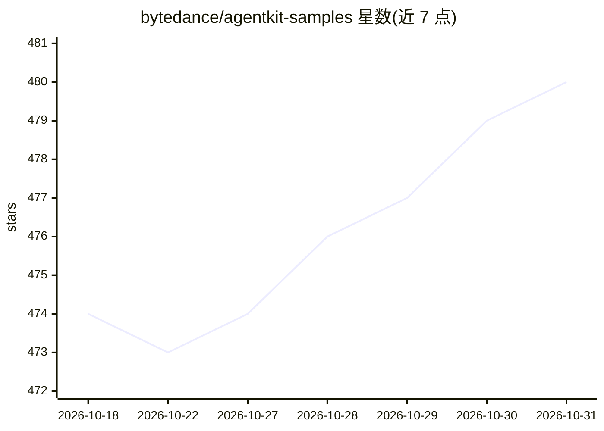

# bytedance/agentkit-samples

⭐ 480 · Python · Apache-2.0 · 推送 2026-10-28 · [GitHub](https://github.com/bytedance/agentkit-samples) · 组织维护 · 中文 README

**火山引擎 AgentKit 平台的示例与教程集合**

字节跳动维护的 AgentKit 代码工坊仓库，收录面向火山引擎 AgentKit 企业级 AI Agent 开发平台的示例与教程，覆盖基础入门到复杂用例：多智能体协作、MCP 集成、基于 VikingDB 的 RAG 与记忆管理、A2A 分布式通信、实时语音助手、数据分析等。运行需 Python 3.10+，安装 veadk-python 与 agentkit-sdk-python 与平台交互，Docker 为可选依赖。AgentKit Runtime 兼容 LangChain、LangGraph 等框架，可通过 migrate 命令迁移现有项目。

## 筛选速览

| 维度 | 判定 | 备注 |
|---|---|---|
| AI 角色 | `ai-knowledge` | 知识聚合/清单类 |
| 许可风险 | `permissive` | Apache-2.0 |
| 部署形态 | `None` |  |
| 模型依赖 | — | README 未给出锁定关系 |
| 硬件要求 | — | 无带数字的原话,不猜 |
| 安装摩擦 | `low` | 无编译、无系统依赖或容器化 |
| 成熟度 | — | 结构信号不足 |

## 能力要点

- 约 19 个示例覆盖基础对话到多智能体协作、RAG、MCP、A2A 等场景
- 环境要求 Python 3.10+，依赖 veadk-python 与 agentkit-sdk-python
- 支持通过 agentkit migrate 将 LangChain/LangGraph 等框架项目迁移到 AgentKit Runtime

## 适用场景

- 学习如何用 VeADK 和 AgentKit SDK 构建 AI Agent 应用
- 参考多智能体协作、RAG 知识库问答等完整实现
- 将现有智能体框架项目迁移到 AgentKit 平台运行部署

## 场景标签

`教程课程` · 领域:学习与行业

## 证据(README 行号)

> L7: 本代码库包含了一系列示例和教程，帮助您理解、实现和集成 AgentKit 的各项功能到您的应用中。
> L13: - **基础教程**：包含了简单的 Agent 示例，能够帮助您快速理解 AgentKit 的基本概念和使用方法
> L11: AgentKit 代码工坊为让您快速上手 AgentKit 平台，提供了不同入门等级的示例和教程：

## 星数曲线

2026-10-18 474 → 2026-10-31 480（+6）

---
*卡片 v1 · prompt 1.4 · 生成 2026-10-21 · 置信度 high · 依据 README sha `d4c5b11e53a8` · [字段定义](../../DATASET.md)*
