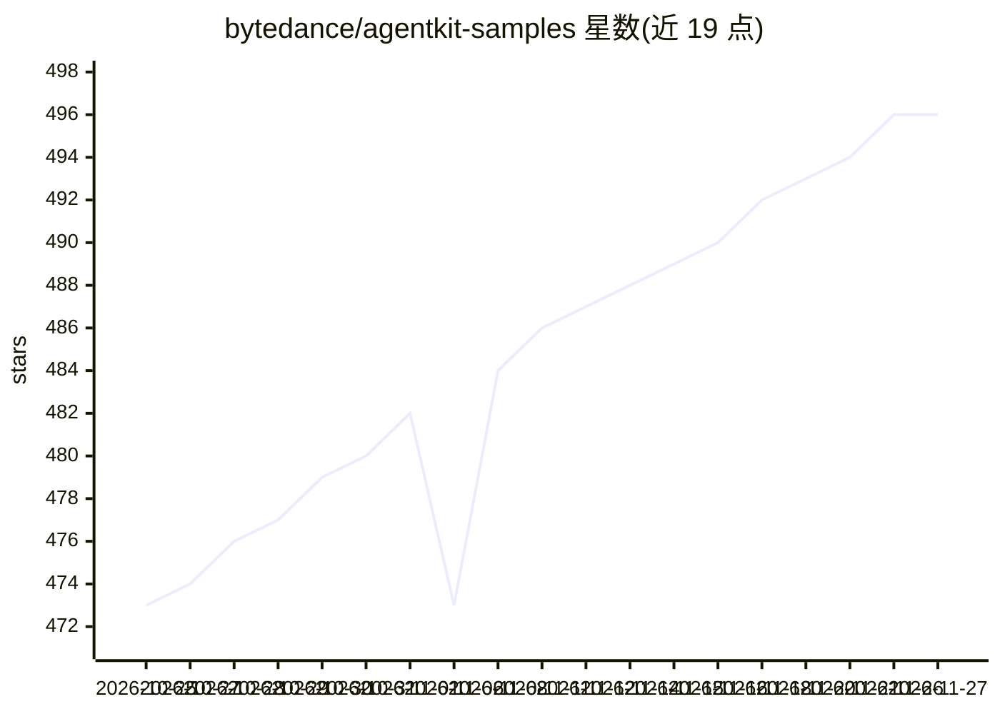

# bytedance/agentkit-samples

⭐ 496 · Python · Apache-2.0 · 推送 2026-11-25 · [GitHub](https://github.com/bytedance/agentkit-samples) · 组织维护 · 中文 README

**为火山引擎 AgentKit 平台开发者提供示例与教程集合**

字节跳动维护的火山引擎 AgentKit 平台示例库，收录约 20 个 Agent 样例，按基础教程与使用案例两个难度层级组织，覆盖多智能体协作、RAG、记忆管理、MCP/A2A 集成、语音聊天、视频生成、数据分析等场景。前置要求 Python 3.10+、veadk-python 与 agentkit-sdk-python，Docker 为可选的本地容器构建工具。README 另说明 Runtime 对主流智能体框架的兼容与迁移命令。

## 筛选速览

| 维度 | 判定 | 备注 |
|---|---|---|
| AI 角色 | `ai-ecosystem` | LLM/agent 周边工具 |
| 许可风险 | `permissive` | Apache-2.0 |
| 部署形态 | `None` |  |
| 模型依赖 | — | README 未给出锁定关系 |
| 硬件要求 | — | 无带数字的原话,不猜 |
| 安装摩擦 | `low` | 无编译、无系统依赖或容器化 |
| 成熟度 | — | 结构信号不足 |

## 能力要点

- 按难度分层的基础教程与使用案例样例列表
- 样例覆盖 RAG（VikingDB）、记忆管理、MCP、A2A 多智能体通信
- AgentKit Runtime 声明兼容 LangChain、LangGraph、Strands、Google ADK 等框架
- 提供 agentkit migrate 迁移命令与迁移示例目录

## 适用场景

- 学习 AgentKit 平台基本概念并上手构建智能体
- 参考多智能体协作、RAG、记忆管理样例实现业务应用
- 将现有 LangChain/LangGraph 等框架项目迁移部署到 AgentKit Runtime
- 搭建客服、点餐、旅行规划等场景智能体时查找参考实现

## 场景标签

`教程课程` `Agent 框架` · 领域:Agent 开发

## 证据(README 行号)

> L5: AgentKit 是火山引擎推出的企业级 AI Agent 开发平台，为开发者提供完整的 Agent 构建、部署和运维解决方案。平台通过标准化的开发工具链和云原生基础设施，显著降低复杂智能体应用的开发部署门槛。
> L7: 本代码库包含了一系列示例和教程，帮助您理解、实现和集成 AgentKit 的各项功能到您的应用中。
> L55: AgentKit Runtime 原生支持主流智能体框架，已兼容 LangChain、LangGraph、Strands、Google ADK，以及基于 Bedrock AgentCore Runtime 构建的项目。无需重写现有

## 星数曲线

2026-10-25 473 → 2026-11-27 496（+23）

---
*卡片 v1 · prompt 1.4 · 生成 2026-11-26 · 置信度 high · 依据 README sha `5c496ff6de0e` · [字段定义](../../DATASET.md)*
