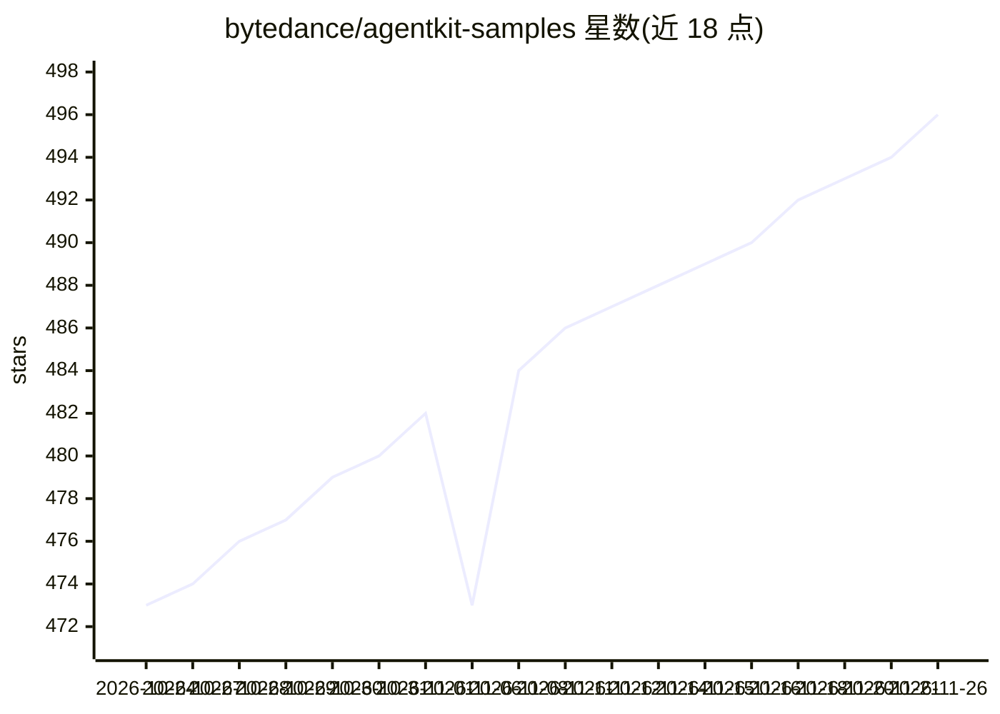

# bytedance/agentkit-samples

⭐ 496 · Python · Apache-2.0 · 推送 2026-11-25 · [GitHub](https://github.com/bytedance/agentkit-samples) · 组织维护 · 中文 README

**火山引擎 AgentKit 平台的示例与教程集合，助开发者上手**

字节跳动/火山引擎维护的 AgentKit 代码工坊仓库，收录面向 Volcengine AgentKit 企业级 Agent 开发平台的示例与教程，按基础教程和使用案例两级组织。样例覆盖基础对话智能体、多智能体协作、RAG（VikingDB）、记忆管理、A2A 通信、MCP 集成、实时语音、视频生成等约 20 个场景。依赖 Python 3.10+、veadk-python 与 agentkit-sdk-python，Docker 可选用于本地容器构建，并提供 agentkit migrate 迁移入口以兼容主流智能体框架。

## 筛选速览

| 维度 | 判定 | 备注 |
|---|---|---|
| AI 角色 | `ai-ecosystem` | LLM/agent 周边工具 |
| 许可风险 | `permissive` | Apache-2.0 |
| 部署形态 | `None` |  |
| 模型依赖 | — | README 未给出锁定关系 |
| 硬件要求 | — | 无带数字的原话,不猜 |
| 安装摩擦 | `low` | 无编译、无系统依赖或容器化 |
| 成熟度 | — | 结构信号不足 |

## 能力要点

- 约 20 个分级样例覆盖对话、多智能体、RAG、记忆、语音、视频生成
- 提供 agentkit migrate 命令将既有项目迁移为可部署的 veadk 项目
- AgentKit Runtime 兼容 LangChain、LangGraph、Strands、Google ADK 等框架
- 附 Hi Agent 与 AgentKit 的双向调用示例（HTTP / JSON-RPC / MCP）

## 适用场景

- 学习在火山引擎 AgentKit 平台上构建和部署 AI Agent
- 参考多智能体协作或 RAG 知识库问答的实现示例
- 将现有智能体项目迁移到 AgentKit Runtime 运行

## 场景标签

`Agent 框架` `多智能体` `RAG` `教程课程` · 领域:Agent 开发

## 证据(README 行号)

> L5: AgentKit 是火山引擎推出的企业级 AI Agent 开发平台，为开发者提供完整的 Agent 构建、部署和运维解决方案。平台通过标准化的开发工具链和云原生基础设施，显著降低复杂智能体应用的开发部署门槛。
> L54: AgentKit Runtime 原生支持主流智能体框架，已兼容 LangChain、LangGraph、Strands、Google ADK，以及基于 Bedrock AgentCore Runtime 构建的项目。无需重写现有

## 星数曲线

2026-10-24 473 → 2026-11-26 496（+23）

---
*卡片 v1 · prompt 1.4 · 生成 2026-11-25 · 置信度 high · 依据 README sha `d0fbd9776b6b` · [字段定义](../../DATASET.md)*
