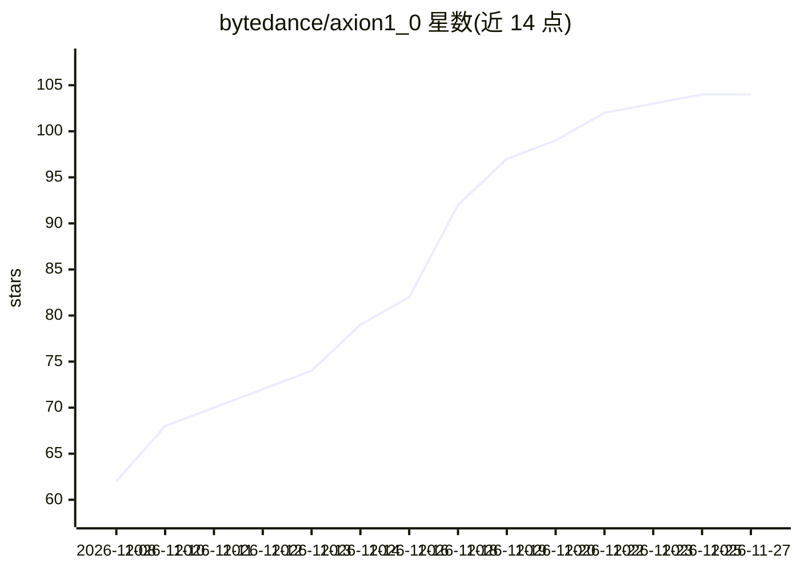

# bytedance/axion1_0

⭐ 104 · Python · Apache-2.0 · 推送 2026-11-11 · [GitHub](https://github.com/bytedance/axion1_0) · [官网](https://axion1-0.github.io) · 组织维护 · 中文 README

**开源 agent 基础模型及完整训练配方（2 SFT+RL）**

Axion 1.0 发布 35B/122B 两档开源 agent 基础模型（基于 Qwen MoE 底座），主打仅用两阶段 SFT 加强化学习、不依赖 mid-training/DPO/蒸馏的训练配方。仓库包含数据生成与过滤、提示词、异步 GRPO 强化学习及基准评测打分代码，训练数据与 35B 社区复现模型托管在 Hugging Face。SFT 基于 Swift 与 Megatron-FSDP，RL 用 verl，推理提供 vLLM 启动命令；122B 配方需 32 GPU、128K 上下文窗口，Apache 2.0 许可。

## 筛选速览

| 维度 | 判定 | 备注 |
|---|---|---|
| AI 角色 | `ai-native` | 本体是模型或模型工具 |
| 许可风险 | `permissive` | Apache-2.0 |
| 部署形态 | `library` | 以包/库形式分发 |
| 模型依赖 | local-ok | 支持本地模型 |
| 硬件要求 | — | 无带数字的原话,不猜 |
| 安装摩擦 | `low` | 无编译、无系统依赖或容器化 |
| 成熟度 | — | 结构信号不足 |

## 能力要点

- 两阶段 SFT + 异步 GRPO 的完整开源训练配方
- 35B/122B 两个模型及 4B/9B 论文变体，训练数据公开于 Hugging Face
- 覆盖数据构建、训练、评测打分的全套代码
- 可验证训练数据：程序化参考答案与检索依赖校验

## 适用场景

- 复现或改进 agent 基础模型的训练流程
- 在科学推理与工具调用任务上部署开源 agent 模型
- 使用其数据构建代码生成可验证的推理训练数据

## 场景标签

`模型训练` `强化学习` `模型评测` · 领域:评测与运维

## 证据(README 行号)

> L21: - **Scientific reasoning and tool use.** Axion 1.0-122B scores **59.0** on full
> L27: - **Open training code.** The repository includes data generation and
> L130: for environment setup, two-stage SFT and checkpoint export. SFT uses Swift with

## 星数曲线

2026-11-08 62 → 2026-11-27 104（+42）

---
*卡片 v1 · prompt 1.4 · 生成 2026-11-18 · 置信度 high · 依据 README sha `d66c07f026ac` · [字段定义](../../DATASET.md)*
