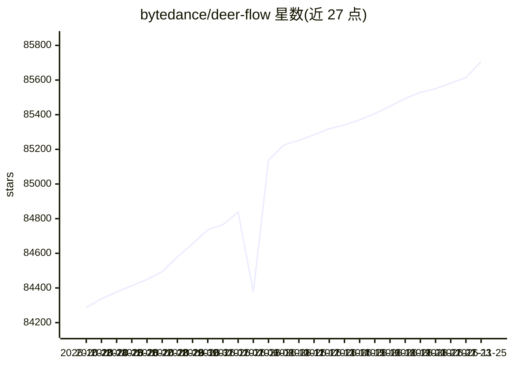

# bytedance/deer-flow

⭐ 85,707 · Python · MIT · 推送 2026-11-24 · [GitHub](https://github.com/bytedance/deer-flow) · [官网](https://deerflow.tech) · 组织维护 · 中文 README

**面向开发者的开源 SuperAgent 运行时：编排子代理执行长时程任务**

DeerFlow（Deep Exploration and Efficient Research Flow）是字节跳动开源的 super agent harness，编排子代理、记忆、沙箱、技能与消息网关来处理数分钟到数小时的任务；起家于 Deep Research 框架，2.0 为全新重写，基于 LangGraph 与 LangChain，内置文件系统、沙箱感知执行与子代理派生能力。支持 Docker 与本地运行（需 Node.js 22+、pnpm、uv、nginx），模型接入为 OpenAI 兼容 API，官方声明可执行命令与读写文件，设计用于本地可信环境。

## 筛选速览

| 维度 | 判定 | 备注 |
|---|---|---|
| AI 角色 | `ai-ecosystem` | LLM/agent 周边工具 |
| 许可风险 | `permissive` | MIT |
| 部署形态 | `library` | 以包/库形式分发 |
| 模型依赖 | — | README 未给出锁定关系 |
| 硬件要求 | — | 无带数字的原话,不猜 |
| 安装摩擦 | `medium` | 含编译或系统依赖之一 |
| 成熟度 | `idea` | |

## 动量与使用信号

- 维护:`active` — 距上次 push 0.8 天,年发版 2,457 位贡献者
- 涨星:近 1 天 **+72**(自 20261016 起算)
- 安装:npm 包 `@minimax-ai/code` 月下载 57,110
- 平台:— · 协议:OPENAI-API / MCP / OLLAMA

## 能力要点

- 编排子代理、记忆、沙箱、技能与消息网关的 agent harness
- 基于 LangGraph 与 LangChain 构建，模型接入为 OpenAI 兼容 API
- 支持 Docker 部署与本地开发（make 工作流，Node.js 22+/pnpm/uv/nginx）
- 支持 MCP 服务器、IM 通道（飞书/Slack/Telegram/Discord/钉钉）与 GitHub 事件驱动

## 适用场景

- 让 agent 自主执行需要数分钟到数小时的多步长时程任务
- 搭建深度研究、数据管道、幻灯片生成、仪表盘等自动化工作流
- 通过 IM 通道或 GitHub webhook 接入事件驱动的 agent

## 场景标签

`Agent 框架` `多智能体` `工作流自动化` · 领域:Agent 开发

## 证据(README 行号)

> L10: DeerFlow (**D**eep **E**xploration and **E**fficient **R**esearch **Flow**) is an open-source **super agent harness
> L100: DeerFlow 2.0 is no longer a framework you wire together. It's a super agent harness — batteries included, fully ex

## 星数曲线

2026-10-23 84,287 → 2026-11-25 85,707（+1,420）

---
*卡片 v1 · prompt 1.4 · 生成 2026-11-23 · 置信度 mid · 依据 README sha `2c17e4f908e8` · [字段定义](../../DATASET.md)*
