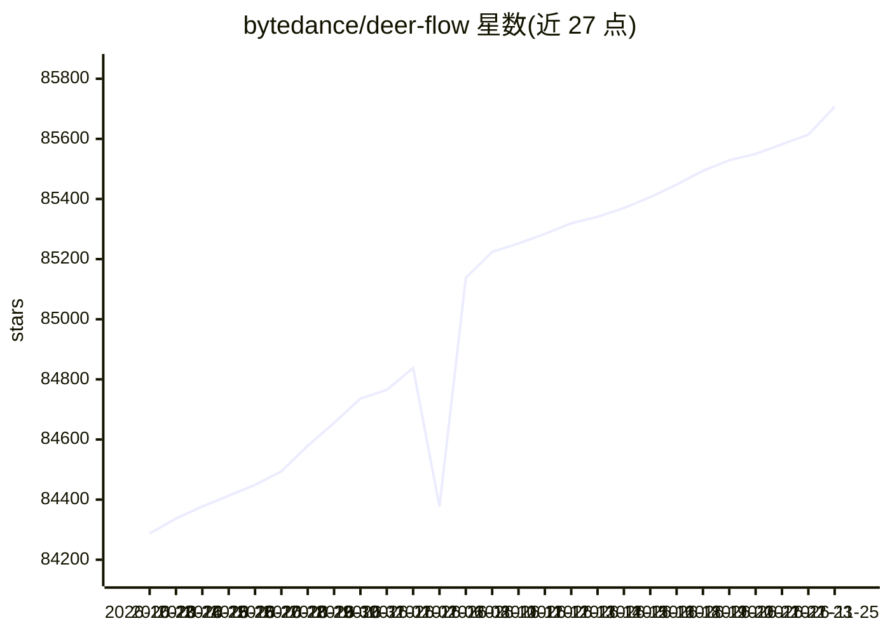

# bytedance/deer-flow

⭐ 85,707 · Python · MIT · 推送 2026-11-24 · [GitHub](https://github.com/bytedance/deer-flow) · [官网](https://deerflow.tech) · 组织维护 · 中文 README

**编排子代理、记忆与沙箱的开源 SuperAgent 运行框架**

由字节跳动开源的 SuperAgent harness（DeerFlow 2.0 为完全重写版本），基于 LangGraph 与 LangChain 构建，内置文件系统、记忆、技能、沙箱执行与子代理规划派生能力，用于处理持续数分钟到数小时的长期任务。提供 Web UI（默认端口 2026）、TUI 终端工作台、API 与 Python 客户端，并支持 IM 渠道、GitHub webhooks、定时任务与可观测性追踪。模型无关，兼容 OpenAI 风格 API；README 提示其可执行命令与读写文件，建议在本地可信环境运行。

## 筛选速览

| 维度 | 判定 | 备注 |
|---|---|---|
| AI 角色 | `ai-ecosystem` | LLM/agent 周边工具 |
| 许可风险 | `permissive` | MIT |
| 部署形态 | `library` | 以包/库形式分发 |
| 模型依赖 | — | README 未给出锁定关系 |
| 硬件要求 | — | 无带数字的原话,不猜 |
| 安装摩擦 | `medium` | 含编译或系统依赖之一 |
| 成熟度 | `idea` | |

## 动量与使用信号

- 维护:`active` — 距上次 push 0.8 天,年发版 2,457 位贡献者
- 涨星:近 1 天 **+72**(自 20261016 起算)
- 安装:npm 包 `@minimax-ai/code` 月下载 57,110
- 平台:— · 协议:OPENAI-API / MCP / OLLAMA

## 能力要点

- 基于 LangGraph/LangChain 的 agent harness，内置文件系统、记忆、技能与沙箱执行
- 支持子代理、agent teams、长期记忆与上下文压缩
- 兼容 OpenAI 风格 API 的模型接入，提供 Docker 与本地两种运行方式
- 覆盖 RAGFlow 私有知识检索、MCP、IM 渠道、定时任务等扩展指南

## 适用场景

- 让 agent 执行深度研究并产出报告/幻灯片等内容
- 搭建可派生子代理的多步骤自动化工作流
- 通过沙箱运行 agent 生成的代码任务
- 接入飞书/Slack/Telegram 等 IM 渠道部署 agent

## 场景标签

`Agent 框架` `多智能体` `科研工具` · 领域:Agent 开发

## 证据(README 行号)

> L10: DeerFlow (**D**eep **E**xploration and **E**fficient **R**esearch **Flow**) is an open-source **super agent harness
> L96: That told us something important: DeerFlow wasn't just a research tool. It was a **harness** — a runtime that gives
> L100: DeerFlow 2.0 is no longer a framework you wire together. It's a super agent harness — batteries included, fully ex

## 星数曲线

2026-10-23 84,287 → 2026-11-25 85,707（+1,420）

---
*卡片 v1 · prompt 1.4 · 生成 2026-11-25 · 置信度 mid · 依据 README sha `6ff8768d90f1` · [字段定义](../../DATASET.md)*
