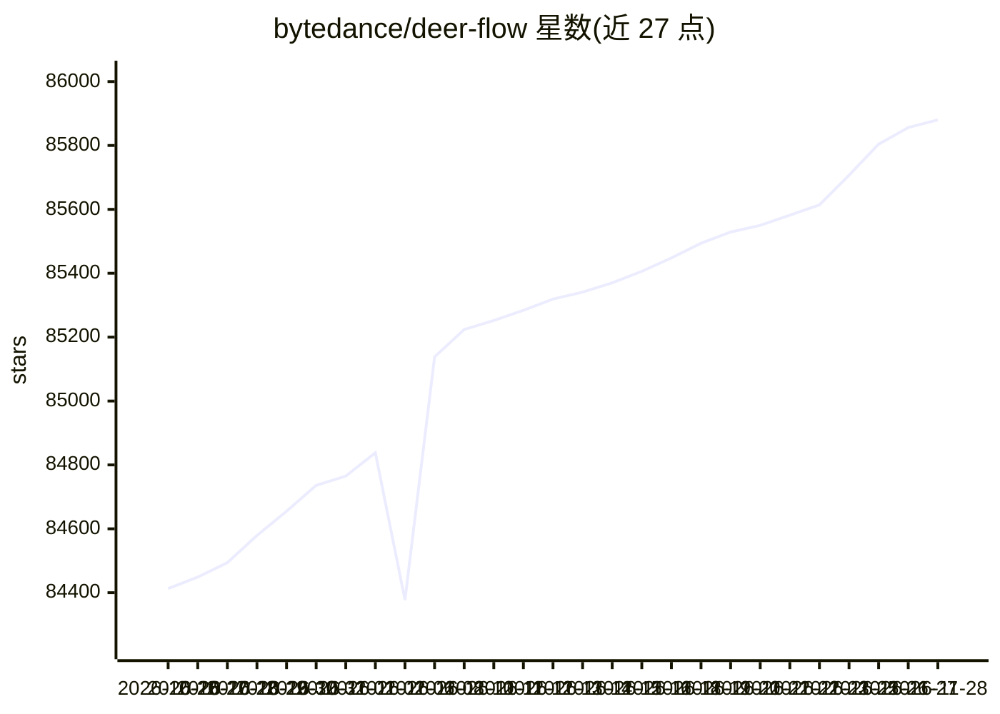

# bytedance/deer-flow

⭐ 85,880 · Python · MIT · 推送 2026-11-27 · [GitHub](https://github.com/bytedance/deer-flow) · [官网](https://deerflow.tech) · 组织维护 · 中文 README

**开源长时程 SuperAgent 运行时：编排子代理与沙箱执行研究、编码、创作任务**

DeerFlow 2.0 是字节跳动开源的 super agent harness，基于 LangGraph 与 LangChain 构建，为 agent 提供文件系统、记忆、技能、沙箱执行与子代理规划生成能力，可处理分钟到小时级的任务。安装走 git clone 后 make setup 交互式向导，推荐 Docker 启动（make docker-init/start），本地运行需 Node.js 22+、pnpm、uv、nginx。模型无关，接受任何 OpenAI 兼容 API。README 附安全提示：默认关闭运行时工具审批，适合本地可信环境。

## 筛选速览

| 维度 | 判定 | 备注 |
|---|---|---|
| AI 角色 | `ai-ecosystem` | LLM/agent 周边工具 |
| 许可风险 | `permissive` | MIT |
| 部署形态 | `library` | 以包/库形式分发 |
| 模型依赖 | — | README 未给出锁定关系 |
| 硬件要求 | — | 无带数字的原话,不猜 |
| 安装摩擦 | `medium` | 含编译或系统依赖之一 |
| 成熟度 | `idea` | |

## 动量与使用信号

- 维护:`active` — 距上次 push 0.8 天,年发版 2,457 位贡献者
- 涨星:近 1 天 **+72**(自 20261016 起算)
- 安装:npm 包 `@minimax-ai/code` 月下载 57,110
- 平台:— · 协议:OPENAI-API / MCP / OLLAMA

## 能力要点

- 编排子代理、记忆、沙箱与可扩展技能的长时程 agent 运行时
- 内置 IM 渠道（飞书/Slack/Telegram 等）与 GitHub webhook 事件驱动
- 模型无关：兼容任何 OpenAI 兼容 API 的 LLM
- 提供 veFaaS/boxd 等多种沙箱 provider 与 RAGFlow 私有知识检索

## 适用场景

- 让 agent 自主完成深度研究与多步数据管道任务
- 通过飞书/Slack 等 IM 渠道接入团队 agent 工作流
- 用沙箱隔离执行 agent 生成的代码与 shell 命令
- 自动化生成幻灯片、仪表盘与内容工作流

## 场景标签

`Agent 框架` `多智能体` `工作流自动化` `科研工具` · 领域:Agent 开发

## 证据(README 行号)

> L10: DeerFlow (**D**eep **E**xploration and **E**fficient **R**esearch **Flow**) is an open-source **super agent harness
> L100: DeerFlow 2.0 is no longer a framework you wire together. It's a super agent harness — batteries included, fully ex
> L137: DeerFlow is model-agnostic — it works with any LLM that implements the OpenAI-compatible API. That said, it perfor

## 星数曲线

2026-10-26 84,413 → 2026-11-28 85,880（+1,467）

---
*卡片 v1 · prompt 1.4 · 生成 2026-11-28 · 置信度 mid · 依据 README sha `a92bb13bb4f5` · [字段定义](../../DATASET.md)*
