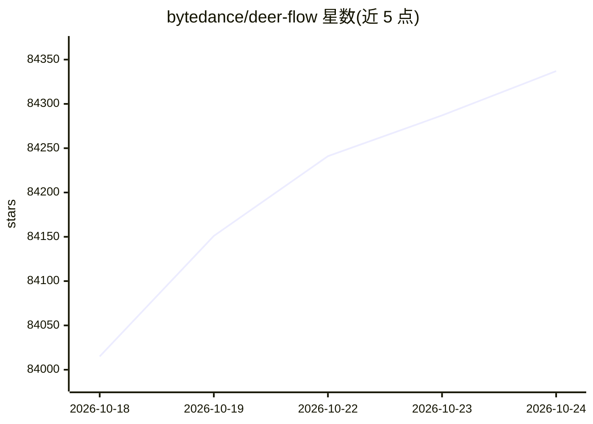

# bytedance/deer-flow

⭐ 84,337 · Python · MIT · 推送 2026-10-23 · [GitHub](https://github.com/bytedance/deer-flow) · [官网](https://deerflow.tech) · 组织维护 · 中文 README

**面向长时程任务的 SuperAgent 编排框架：研究、编码与创作**

DeerFlow 2.0 是字节跳动开源的 SuperAgent 编排框架（harness），通过子代理、记忆、沙箱、技能扩展与消息网关组织任务，可处理耗时数分钟到数小时的深研究、编码与内容生成任务。面向希望搭建多代理工作流的开发者，基于 Python 与 Node.js。安装路径为克隆仓库后运行 make setup 交互式向导选择 LLM 提供商、搜索与沙箱配置，支持 Docker 部署与 make doctor 自检；需注意 2.0 为完全重写，与 1.x 分支不共享代码。

## 筛选速览

| 维度 | 判定 | 备注 |
|---|---|---|
| AI 角色 | `ai-ecosystem` | LLM/agent 周边工具 |
| 许可风险 | `permissive` | MIT |
| 部署形态 | `desktop` | 安装包/桌面程序 |
| 模型依赖 | locked-api |  |
| 硬件要求 | — | 无带数字的原话,不猜 |
| 安装摩擦 | `low` | 无编译、无系统依赖或容器化 |
| 成熟度 | — | 结构信号不足 |

## 动量与使用信号

- 维护:`active` — 距上次 push 0.8 天,年发版 2,457 位贡献者
- 涨星:近 1 天 **+72**(自 20261016 起算)
- 安装:npm 包 `@minimax-ai/code` 月下载 57,110
- 平台:— · 协议:OPENAI-API / MCP / OLLAMA

## 能力要点

- 编排子代理、记忆、沙箱与可扩展技能的长时程任务处理
- make setup 交互式向导生成 config.yaml 与 .env
- 支持 Brave/Tavily/SearXNG/DuckDuckGo/InfoQuest 等多种搜索与抓取后端
- 自带抓取后端网络隔离检查与 make doctor 诊断

## 适用场景

- 搭建执行深度研究的多代理工作流
- 让 agent 在沙箱中完成编码类长时任务
- 为已有 LLM 接入可扩展的技能与子代理体系

## 场景标签

`Agent 框架` `多智能体` · 领域:Agent 开发

## 证据(README 行号)

> L12: DeerFlow (**D**eep **E**xploration and **E**fficient **R**esearch **Flow**) is an open-source **super agent harness
> L17: > **DeerFlow 2.0 is a ground-up rewrite.** It shares no code with v1. If you're looking for the original Deep Resea
> L100:    make setup

## 星数曲线

2026-10-18 84,015 → 2026-10-24 84,337（+322）

---
*卡片 v1 · prompt 1.4 · 生成 2026-10-20 · 置信度 mid · 依据 README sha `31e95b02ff83` · [字段定义](../../DATASET.md)*
