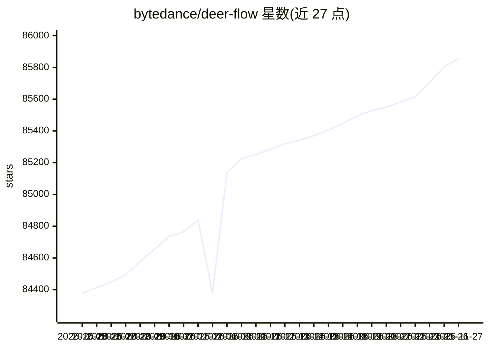

# bytedance/deer-flow

⭐ 85,856 · Python · MIT · 推送 2026-11-26 · [GitHub](https://github.com/bytedance/deer-flow) · [官网](https://deerflow.tech) · 组织维护 · 中文 README

**面向开发者的长时程 SuperAgent 运行时：编排子代理、沙箱与技能执行研究/编码/创作任务**

DeerFlow（Deep Exploration and Efficient Research Flow）是字节跳动开源的 SuperAgent harness，基于 LangGraph 与 LangChain 构建，内置文件系统、长期记忆、技能、沙箱执行与子代理编排能力，处理从分钟到小时级的多步任务。前身是 Deep Research 框架，2.0 为完全重写（旧版本维护于 1.x 分支）。支持 Docker 或本地运行，模型侧采用 OpenAI 兼容 API 接入；README 附安全提示：默认在本地可信环境运行，工具审批默认关闭。

## 筛选速览

| 维度 | 判定 | 备注 |
|---|---|---|
| AI 角色 | `ai-ecosystem` | LLM/agent 周边工具 |
| 许可风险 | `permissive` | MIT |
| 部署形态 | `library` | 以包/库形式分发 |
| 模型依赖 | — | README 未给出锁定关系 |
| 硬件要求 | — | 无带数字的原话,不猜 |
| 安装摩擦 | `medium` | 含编译或系统依赖之一 |
| 成熟度 | `idea` | |

## 动量与使用信号

- 维护:`active` — 距上次 push 0.8 天,年发版 2,457 位贡献者
- 涨星:近 1 天 **+72**(自 20261016 起算)
- 安装:npm 包 `@minimax-ai/code` 月下载 57,110
- 平台:— · 协议:OPENAI-API / MCP / OLLAMA

## 能力要点

- 内置文件系统、长期记忆、技能与沙箱执行，支持规划并派生子代理
- 模型无关：兼容任何 OpenAI-compatible API 的 LLM
- 支持 MCP Server、RAGFlow 私有知识检索、GitHub 事件驱动与 Feishu/Slack/Telegram 等 IM 渠道
- 提供 Token 用量面板、TUI 终端工作台、API 与 Python 客户端及可观测性集成（LangSmith/Langfuse）

## 适用场景

- 搭建能自主完成长时程研究与编码任务的 agent 运行时
- 通过 IM 渠道或 GitHub webhook 接入事件驱动自动化工作流
- 以沙箱隔离执行 agent 生成的命令与文件操作
- 接入私有知识库做检索增强的研究任务

## 场景标签

`Agent 框架` `多智能体` `Agent 记忆` `RAG` · 领域:Agent 开发

## 证据(README 行号)

> L10: DeerFlow (**D**eep **E**xploration and **E**fficient **R**esearch **Flow**) is an open-source **super agent harness
> L100: DeerFlow 2.0 is no longer a framework you wire together. It's a super agent harness — batteries included, fully ex
> L137: DeerFlow is model-agnostic — it works with any LLM that implements the OpenAI-compatible API. That said, it perfor

## 星数曲线

2026-10-25 84,377 → 2026-11-27 85,856（+1,479）

---
*卡片 v1 · prompt 1.4 · 生成 2026-11-27 · 置信度 mid · 依据 README sha `574e77e16398` · [字段定义](../../DATASET.md)*
