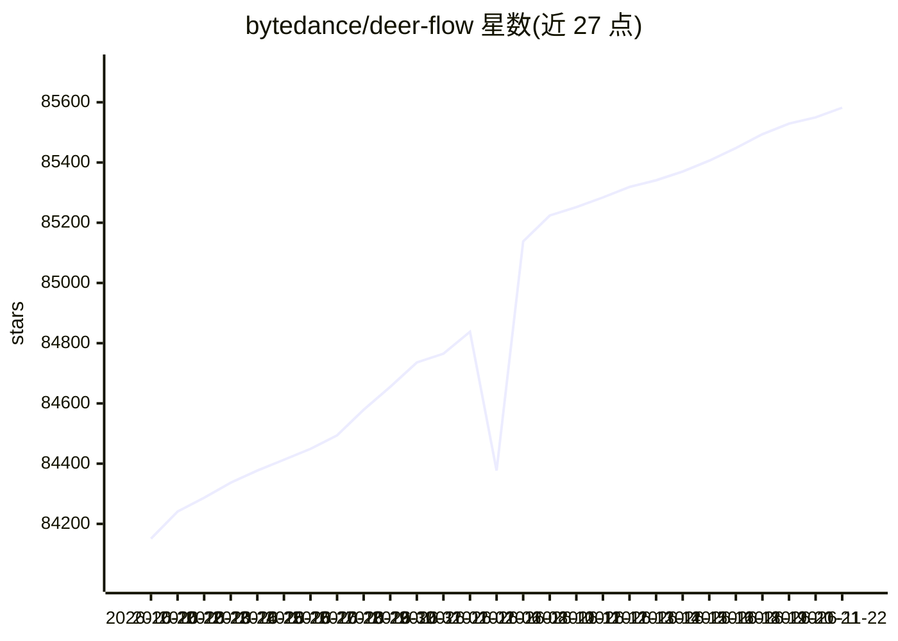

# bytedance/deer-flow

⭐ 85,582 · Python · MIT · 推送 2026-11-21 · [GitHub](https://github.com/bytedance/deer-flow) · [官网](https://deerflow.tech) · 组织维护 · 中文 README

**开源 SuperAgent 运行时：编排子代理执行长时任务**

DeerFlow 是字节跳动开源的长时程 SuperAgent harness，从 Deep Research 框架重写为 2.0 版：基于 LangGraph 和 LangChain 构建，内置文件系统、长期记忆、可扩展技能、沙箱感知执行，支持规划和生成子代理处理多步任务。可接入任意 OpenAI 兼容 API 的 LLM；支持 Docker 或本地 Node.js/Python 环境运行，提供 Web UI、IM 渠道集成、MCP server、API 与 Python 客户端。MIT 许可，官方提示其可执行命令和读写文件，建议在本地可信环境运行。

## 筛选速览

| 维度 | 判定 | 备注 |
|---|---|---|
| AI 角色 | `ai-ecosystem` | LLM/agent 周边工具 |
| 许可风险 | `permissive` | MIT |
| 部署形态 | `library` | 以包/库形式分发 |
| 模型依赖 | — | README 未给出锁定关系 |
| 硬件要求 | — | 无带数字的原话,不猜 |
| 安装摩擦 | `medium` | 含编译或系统依赖之一 |
| 成熟度 | — | 结构信号不足 |

## 动量与使用信号

- 维护:`active` — 距上次 push 0.8 天,年发版 2,457 位贡献者
- 涨星:近 1 天 **+72**(自 20261016 起算)
- 安装:npm 包 `@minimax-ai/code` 月下载 57,110
- 平台:— · 协议:OPENAI-API / MCP / OLLAMA

## 能力要点

- 基于 LangGraph/LangChain 的 SuperAgent harness，支持子代理、记忆、技能、沙箱
- 模型无关：接入任意 OpenAI 兼容 API 的 LLM
- 支持 Docker 部署与本地开发两种运行方式
- 内置 MCP server、IM 渠道、API/Python 客户端、可观测性追踪

## 适用场景

- 让 agent 自主完成深度研究与多步任务
- 构建数据管线、生成幻灯片、自动化内容工作流
- 接入飞书/Slack/Telegram 等 IM 渠道作为对话入口

## 场景标签

`Agent 框架` `多智能体` `Agent 记忆` · 领域:Agent 开发

## 证据(README 行号)

> L10: DeerFlow (**D**eep **E**xploration and **E**fficient **R**esearch **Flow**) is an open-source **super agent harness
> L99: DeerFlow 2.0 is no longer a framework you wire together. It's a super agent harness — batteries included, fully ext
> L133: DeerFlow is model-agnostic — it works with any LLM that implements the OpenAI-compatible API. That said, it perfor

## 星数曲线

2026-10-20 84,151 → 2026-11-22 85,582（+1,431）

---
*卡片 v1 · prompt 1.4 · 生成 2026-11-22 · 置信度 mid · 依据 README sha `dec85f4424c7` · [字段定义](../../DATASET.md)*
