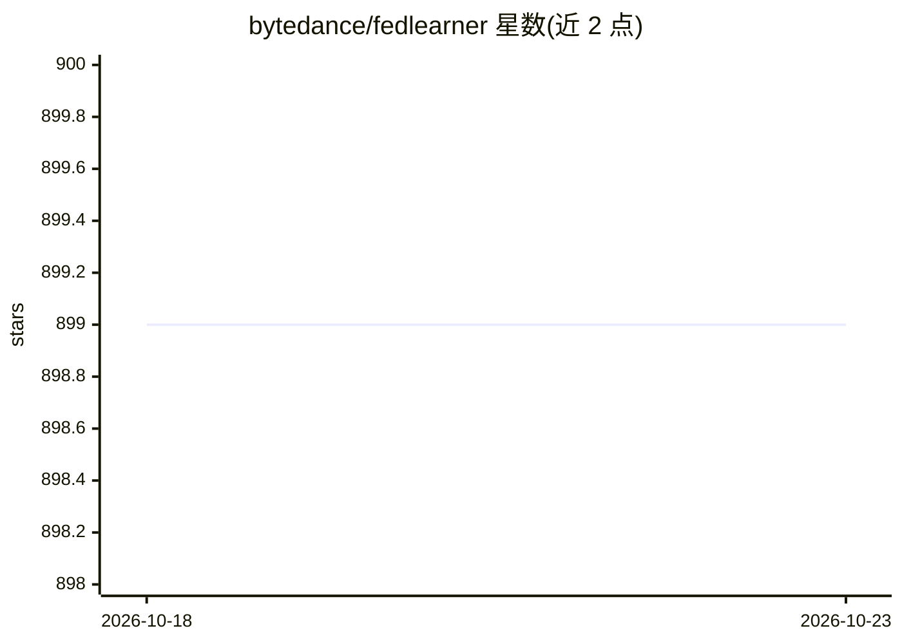

# bytedance/fedlearner

⭐ 899 · Python · Apache-2.0 · 推送 2026-07-06 · [GitHub](https://github.com/bytedance/fedlearner) · 组织维护

**多方协作机器学习框架：跨机构联合建模**

Fedlearner 是字节跳动开源的多方协作机器学习框架，支持在数据分布于不同机构的前提下进行联合建模。README 主要说明项目定位与商标使用政策：允许基于或修改该开源软件构建项目，但对 Fedlearner 商标及产品名称的使用设定了条件，特定商业用途或组合使用需联系获取明确许可。README 未展示安装步骤、依赖或运行方式等细节。

## 筛选速览

| 维度 | 判定 | 备注 |
|---|---|---|
| AI 角色 | `ai-ecosystem` | LLM/agent 周边工具 |
| 许可风险 | `permissive` | Apache-2.0 |
| 部署形态 | `None` |  |
| 模型依赖 | — | README 未给出锁定关系 |
| 硬件要求 | — | 无带数字的原话,不猜 |
| 安装摩擦 | `low` | 无编译、无系统依赖或容器化 |
| 成熟度 | — | 结构信号不足 |

## 能力要点

- 支持跨机构分布式数据的联合建模
- 以开源软件形式提供，允许修改与二次构建
- README 明确商标使用政策与授权边界

## 适用场景

- 多个机构在不交换原始数据的情况下联合训练模型
- 金融或医疗等数据敏感行业的协作建模场景

## 场景标签

 · 领域:机器学习框架/隐私计算

## 证据(README 行号)

> L2: Fedlearner is collaborative machine learning framework that enables joint modeling of data distributed between insti

## 星数曲线

2026-10-18 899 → 2026-10-23 899（+0）

---
*卡片 v1 · prompt 1.4 · 生成 2026-10-21 · 置信度 mid · 依据 README sha `d001a3dc028b` · [字段定义](../../DATASET.md)*
