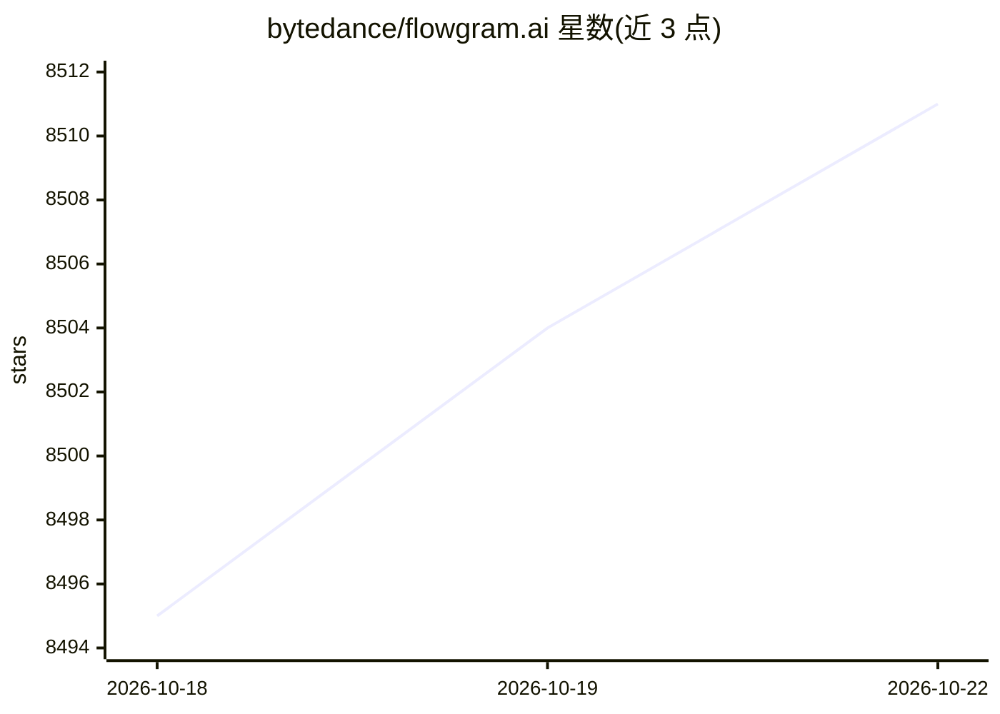

# bytedance/flowgram.ai

⭐ 8,512 · TypeScript · MIT · 推送 2026-10-22 · [GitHub](https://github.com/bytedance/flowgram.ai) · [官网](https://flowgram.ai) · 组织维护 · 中文 README

**可视化 AI 工作流开发框架，助开发者搭建工作流平台**

由字节跳动维护的 TypeScript 工作流开发框架与工具集，提供自由布局/固定布局画布、节点配置表单引擎、变量作用域链与类型推断，以及 LLM、条件、代码编辑器等开箱即用物料。定位为构建 AI 工作流平台的框架而非成品平台，通过 npx 脚手架创建项目、npm 安装运行，面向集成到自研平台的开发者。Coze Studio、NNDeploy 等项目采用该框架。

## 筛选速览

| 维度 | 判定 | 备注 |
|---|---|---|
| AI 角色 | `ai-ecosystem` | LLM/agent 周边工具 |
| 许可风险 | `permissive` | MIT |
| 部署形态 | `library` | 以包/库形式分发 |
| 模型依赖 | — | README 未给出锁定关系 |
| 硬件要求 | — | 无带数字的原话,不猜 |
| 安装摩擦 | `low` | 无编译、无系统依赖或容器化 |
| 成熟度 | — | 结构信号不足 |

## 能力要点

- 自由布局与固定布局两种画布模式，支持分支/循环复合节点
- 表单引擎提供节点数据 CRUD、校验、联动与错误捕获
- 变量引擎支持作用域约束、结构检查与类型推断
- 内置 LLM、条件、代码编辑器等物料

## 适用场景

- 为自研平台搭建可视化工作流编辑器
- 构建 AI agent/LLM 编排平台的前端画布
- 需要分支、循环等复合节点的工作流应用

## 场景标签

`工作流自动化` `Agent 框架` · 领域:Agent 开发

## 证据(README 行号)

> L9: FlowGram is a composable, visual, easy-to-integrate, and extensible workflow development framework & toolkit.
> L11: FlowGram comes with a suite of built-in tools for workflow development: flow canvas, node configuration form, varia

## 星数曲线

2026-10-18 8,495 → 2026-10-22 8,511（+16）

---
*卡片 v1 · prompt 1.4 · 生成 2026-10-20 · 置信度 high · 依据 README sha `9dcad61352ca` · [字段定义](../../DATASET.md)*
