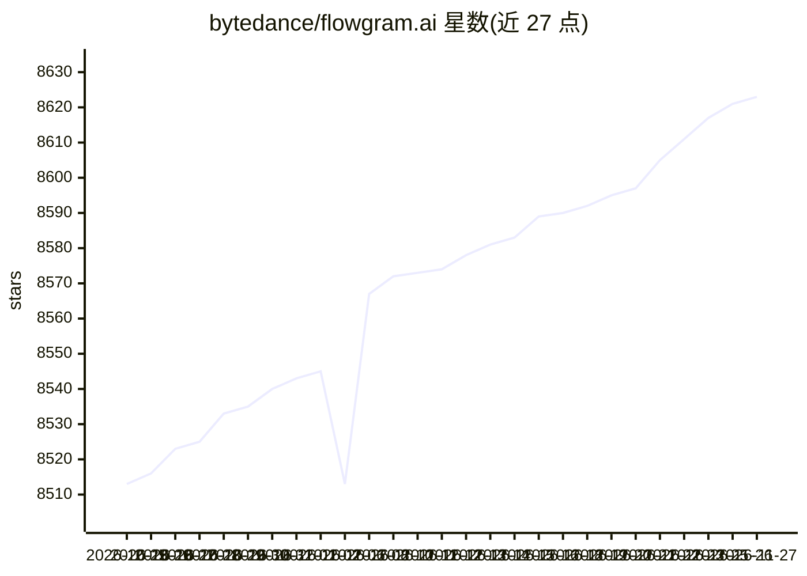

# bytedance/flowgram.ai

⭐ 8,623 · TypeScript · MIT · 推送 2026-11-16 · [GitHub](https://github.com/bytedance/flowgram.ai) · [官网](https://flowgram.ai) · 组织维护 · 中文 README

**给开发者的可视化 AI 工作流开发框架与桌面端**

FlowGram 是字节跳动开源的可组合工作流开发框架，内置流程画布、节点配置表单、变量作用域链及 LLM、条件、代码编辑器等现成物料，供开发者搭建 AI 工作流平台。提供自由/固定两种画布布局，表单引擎支持校验、联动与副作用处理，变量引擎支持类型推断。另有 FlowGram Desktop 桌面端（macOS/Windows），支持对话式构建、节点调试、工作流版本发布为 HTTP 与 MCP 服务，含中英文界面。提供 npx 脚手架创建项目及安装包下载。

## 筛选速览

| 维度 | 判定 | 备注 |
|---|---|---|
| AI 角色 | `ai-ecosystem` | LLM/agent 周边工具 |
| 许可风险 | `permissive` | MIT |
| 部署形态 | `desktop` | 安装包/桌面程序 |
| 模型依赖 | — | README 未给出锁定关系 |
| 硬件要求 | — | 无带数字的原话,不猜 |
| 安装摩擦 | `low` | 无编译、无系统依赖或容器化 |
| 成熟度 | — | 结构信号不足 |

## 能力要点

- 内置画布、表单引擎、变量引擎与 LLM/条件/代码节点等物料
- 自由布局与固定布局两种画布，支持分支、循环节点
- 桌面端支持工作流发布为 HTTP 与 MCP 服务、历史快照回溯
- npx 脚手架一键创建项目，桌面端提供 macOS/Windows 安装包

## 适用场景

- 搭建面向业务的可视化 AI 工作流平台
- 用对话加画布方式构建、调试并复用 Agent 工作流
- 将工作流以 HTTP/MCP 服务形式发布给其他系统调用

## 场景标签

`工作流自动化` · 领域:效率与自动化

## 证据(README 行号)

> L9: FlowGram is a composable, visual, easy-to-integrate, and extensible workflow development framework & toolkit.
> L10: Our goal is to help developers build AI workflow platforms **faster** and **simpler**.
> L11: FlowGram comes with a suite of built-in tools for workflow development: flow canvas, node configuration form, varia

## 星数曲线

2026-10-25 8,513 → 2026-11-27 8,623（+110）

---
*卡片 v1 · prompt 1.4 · 生成 2026-11-22 · 置信度 high · 依据 README sha `36552c248aa3` · [字段定义](../../DATASET.md)*
