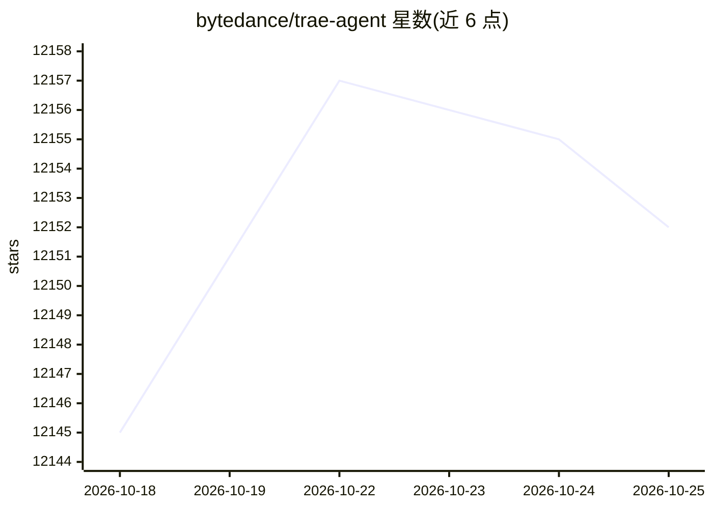

# bytedance/trae-agent

⭐ 12,152 · Python · MIT · 推送 2026-02-05 · [GitHub](https://github.com/bytedance/trae-agent) · [官网](https://www.trae.ai/) · 组织维护 · 中文 README

**面向软件工程任务的 LLM CLI agent，支持多模型与轨迹记录**

字节跳动 Trae 团队开源的通用软件工程 CLI agent：接收自然语言指令，通过文件编辑、bash 执行、顺序思考等工具执行编码任务。支持 OpenAI、Anthropic、豆包、Azure、OpenRouter、Ollama、Gemini 等多种 LLM API，配置基于 YAML 与环境变量，可选 MCP 服务接入。特色包括 Lakeview 步骤摘要、执行轨迹记录（用于调试与分析），以及用 Docker 容器隔离运行任务。架构透明模块化，定位为研究 AI agent 结构与消融实验的可扩展平台；项目仍在活跃开发中。

## 筛选速览

| 维度 | 判定 | 备注 |
|---|---|---|
| AI 角色 | `ai-native` | 本体是模型或模型工具 |
| 许可风险 | `permissive` | MIT |
| 部署形态 | `None` |  |
| 模型依赖 | local-ok | 支持本地模型 |
| 硬件要求 | — | 无带数字的原话,不猜 |
| 安装摩擦 | `low` | 无编译、无系统依赖或容器化 |
| 成熟度 | `idea` | |

## 能力要点

- 多 LLM 提供商支持：OpenAI/Anthropic/豆包/Azure/OpenRouter/Ollama/Gemini
- 执行轨迹自动记录为 JSON（LLM 交互、工具使用、元数据）
- 可在指定 Docker 镜像内隔离运行任务
- MCP 服务可选接入，YAML 配置与命令行/环境变量多级优先级

## 适用场景

- 用自然语言指令让 agent 完成编码、修 bug、加测试等软件工程任务
- 研究人员基于模块化架构做 agent 消融实验与新能力开发
- 借助轨迹记录调试和分析 agent 行为

## 场景标签

`编码 Agent` · 领域:编码与开发

## 证据(README 行号)

> L9: **Trae Agent** is an LLM-based agent for general purpose software engineering tasks. It provides a powerful CLI inte
> L20: - 🤖 **Multi-LLM Support**: Works with OpenAI, Anthropic, Doubao, Azure, OpenRouter, Ollama and Google Gemini APIs
> L15: **Difference with Other CLI Agents:** Trae Agent offers a transparent, modular architecture that researchers and de

## 星数曲线

2026-10-18 12,145 → 2026-10-25 12,152（+7）

---
*卡片 v1 · prompt 1.4 · 生成 2026-10-20 · 置信度 high · 依据 README sha `e71c744ecaeb` · [字段定义](../../DATASET.md)*
