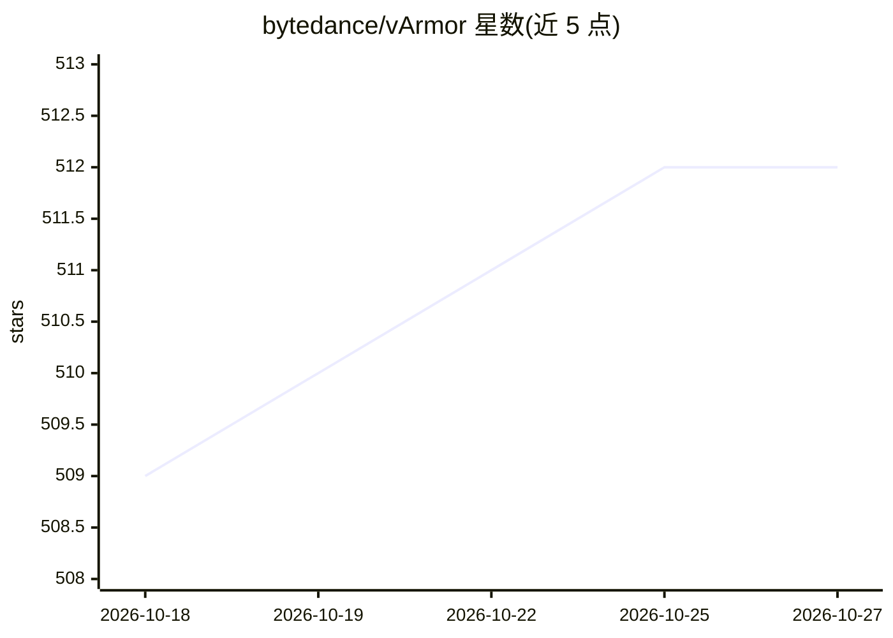

# bytedance/vArmor

⭐ 512 · Go · Apache-2.0 · 推送 2026-10-26 · [GitHub](https://github.com/bytedance/vArmor) · [官网](https://varmor.org) · 组织维护 · 中文 README

**云原生容器加固系统：为 K8s 工作负载（含 AI Agent）实施强制访问控制**

字节跳动 Elkeid 团队维护的 Kubernetes Operator 模式容器加固系统，将 AppArmor LSM、BPF LSM、Seccomp 抽象为 enforcer，可单独或组合使用，对容器文件访问、进程执行、系统调用实施访问控制；另提供基于 Envoy sidecar 的 NetworkProxy enforcer，在 L4/L7 与 TLS SNI 层面管控出站流量，支持 TLS MITM、按域名 HTTP 头注入、防 Domain-Fronting、审计日志与不重启 Pod 的策略更新。文档声明 runc + vArmor 的隔离强度不等同于硬件虚拟化容器。

## 筛选速览

| 维度 | 判定 | 备注 |
|---|---|---|
| AI 角色 | `ai-enhanced` | 去掉 AI 部分产品仍成立 |
| 许可风险 | `permissive` | Apache-2.0 |
| 部署形态 | `None` |  |
| 模型依赖 | — | README 未给出锁定关系 |
| 硬件要求 | — | 无带数字的原话,不猜 |
| 安装摩擦 | `low` | 无编译、无系统依赖或容器化 |
| 成熟度 | — | 结构信号不足 |

## 能力要点

- AppArmor/BPF/Seccomp/NetworkProxy 四类 enforcer，可单独或组合使用
- NetworkProxy 在 L4/L7 及 TLS SNI 层管控出站流量，支持审计日志与动态策略更新
- 面向 AI Agent 工作负载的纵深防护：内核级 MAC 结合应用层协议级网络管控
- 内置规则与 Allow-by-Default 模型，无需安全 profile 专业知识即可使用

## 适用场景

- 多租户 Kubernetes 集群中无法使用硬件虚拟化容器时加固隔离
- 管控 AI Agent / LLM 应用的出站网络访问，防数据外泄与未授权 API 调用
- 高危漏洞无法及时修补时阻断或提高利用难度
- 对关键业务容器阻止提权、逃逸与横向移动

## 场景标签

`网络安全` · 领域:学习与行业

## 证据(README 行号)

> L11: vArmor is a cloud-native container hardening system. It leverages Linux's AppArmor LSM, BPF LSM, Seccomp, and **Net
> L26: * **AI Agent Protection**. vArmor provides defense-in-depth for AI Agent workloads by combining kernel-level mandat

## 星数曲线

2026-10-18 509 → 2026-10-27 512（+3）

---
*卡片 v1 · prompt 1.4 · 生成 2026-10-21 · 置信度 high · 依据 README sha `80284eadc9a5` · [字段定义](../../DATASET.md)*
