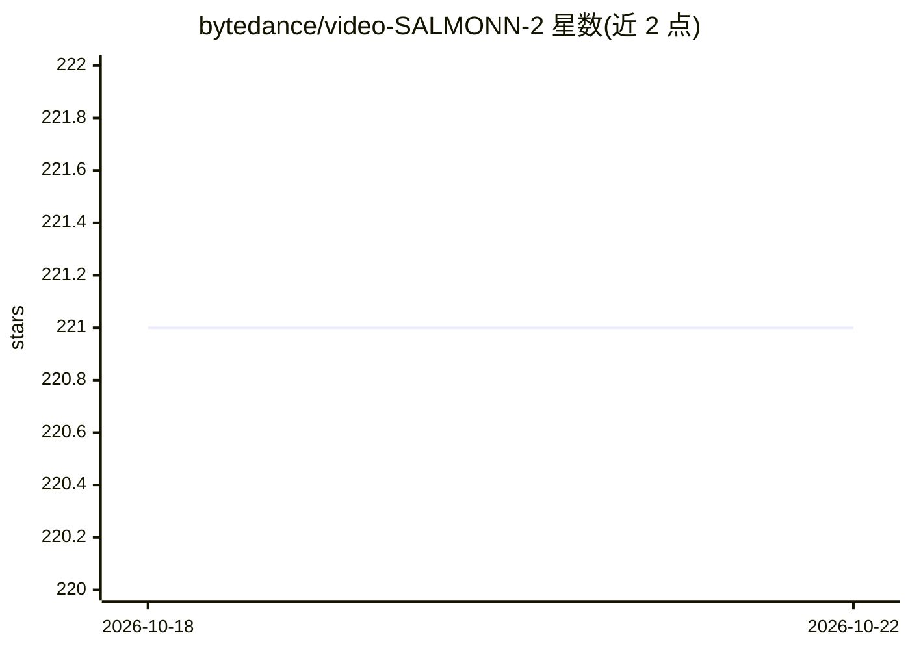

# bytedance/video-SALMONN-2

⭐ 221 · Python · Apache-2.0 · 推送 2026-09-02 · [GitHub](https://github.com/bytedance/video-SALMONN-2) · 组织维护 · 中文 README

**音视频大语言模型：为视频生成含音频理解的字幕描述**

video-SALMONN 2 是由清华大学电子工程系与字节跳动开发的音视频多模态大语言模型，读取视频（含音频）输入，生成音视频视频字幕，并支持音视频问答。提供 3B/7B/72B（video-SALMONN 2+）与基于 Qwen3-VL 骨干的 4B/8B/32B Pro 版本的代码与权重，Pro 版本支持 vLLM 推理以提升字幕生成吞吐。README 给出训练（SFT/DPO）与评测脚本的运行步骤，需自行从 HuggingFace 下载基座模型并准备数据集。

## 筛选速览

| 维度 | 判定 | 备注 |
|---|---|---|
| AI 角色 | `ai-native` | 本体是模型或模型工具 |
| 许可风险 | `permissive` | Apache-2.0 |
| 部署形态 | `None` |  |
| 模型依赖 | local-ok | 支持本地模型 |
| 硬件要求 | — | 无带数字的原话,不猜 |
| 安装摩擦 | `low` | 无编译、无系统依赖或容器化 |
| 成熟度 | — | 结构信号不足 |

## 能力要点

- 生成含音频理解的视频字幕（audio-visual video captioning）
- 多个规模版本的代码与 checkpoint（3B–72B，Pro 4B/8B/32B 基于 Qwen3-VL 骨干）
- Pro 版本支持 vLLM 推理，提升字幕生成吞吐与延迟
- 提供 SFT/DPO 训练脚本与评测脚本

## 适用场景

- 为视频数据批量生成包含音频信息的字幕描述
- 在 Video-MME、WorldSense 等音视频问答基准上做研究评测
- 基于开源权重微调自己的音视频理解模型

## 场景标签

`多模态` `微调` · 领域:感知与多模态

## 证据(README 行号)

> L5: video-SALMONN 2 is a powerful audio-visual large language model (LLM) that **generates high-quality audio-visual vid
> L9: - **2026-09-03**: We release the code and checkpoint of video-SALMONN 2 pro 4B, 8B, and 32B. Based on Qwen3-VL backb

## 星数曲线

2026-10-18 221 → 2026-10-22 221（+0）

---
*卡片 v1 · prompt 1.4 · 生成 2026-10-22 · 置信度 high · 依据 README sha `65e2061c4518` · [字段定义](../../DATASET.md)*
