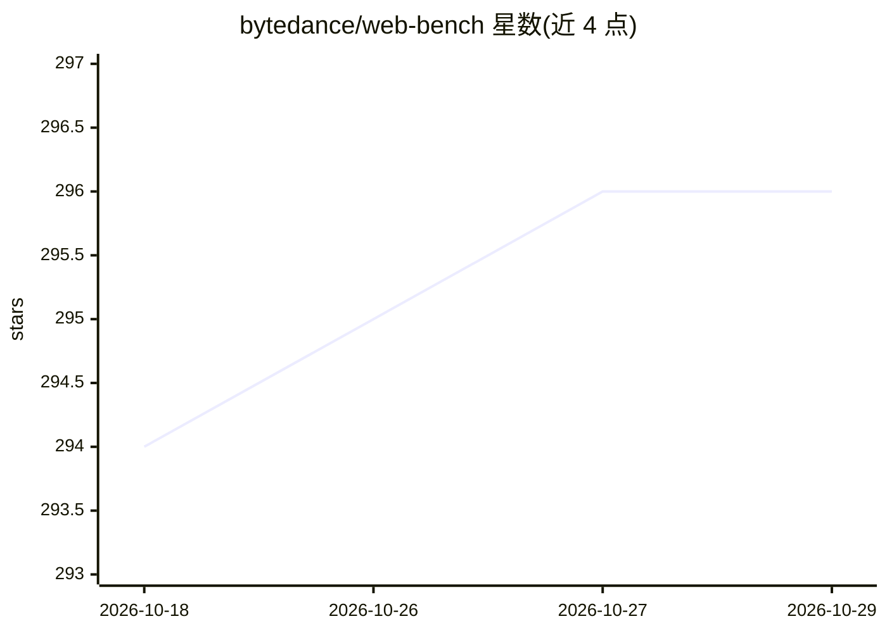

# bytedance/web-bench

⭐ 296 · JavaScript · Apache-2.0 · 推送 2026-04-30 · [GitHub](https://github.com/bytedance/web-bench) · [官网](https://huggingface.co/spaces/bytedance-research/Web-Bench-Leaderboard) · 组织维护 · 中文 README

**评测 LLM 真实 Web 开发能力的基准：50 项目×20 顺序任务**

字节跳动发布的 Web 开发领域 LLM 代码基准：包含 50 个项目、每项目 20 个具有顺序依赖关系的任务，模拟真实人类开发流程，覆盖 Web 标准与 Web 框架；项目由 5-10 年经验工程师设计，资深工程师平均需 4-8 小时完成。提供基准 Agent（Web-Agent）进行评测，SOTA（Claude 3.7 Sonnet）Pass@1 为 25.1%。通过 Docker Compose 运行，评测报告生成于 ./report/，也可从源码安装。

## 筛选速览

| 维度 | 判定 | 备注 |
|---|---|---|
| AI 角色 | `ai-ecosystem` | LLM/agent 周边工具 |
| 许可风险 | `permissive` | Apache-2.0 |
| 部署形态 | `self-host` | docker 或自建部署 |
| 模型依赖 | — | README 未给出锁定关系 |
| 硬件要求 | — | 无带数字的原话,不猜 |
| 安装摩擦 | `low` | 无编译、无系统依赖或容器化 |
| 成熟度 | — | 结构信号不足 |

## 能力要点

- 50 个项目、每项目 20 个顺序依赖任务
- 覆盖 Web 标准与 Web 框架两大要素
- 配套基准 Agent（Web-Agent），SOTA Pass@1 为 25.1%
- Docker Compose 一键运行并生成评测报告

## 适用场景

- 评测不同 LLM 在真实 Web 开发任务上的代码生成能力
- 对比模型与 SWE-bench、HumanEval 等基准的差距
- 为选型或研究提供 Web 开发维度的量化依据

## 场景标签

`模型评测` · 领域:评测与运维

## 证据(README 行号)

> L12: **Web-Bench** is a benchmark designed to evaluate the performance of LLMs in actual Web development. Web-Bench cont
> L18: HumanEval and MBPP have approached saturation. APPS and EvalPlus are approaching saturation. The SOTA for Web-Bench

## 星数曲线

2026-10-18 294 → 2026-10-29 296（+2）

---
*卡片 v1 · prompt 1.4 · 生成 2026-10-21 · 置信度 high · 依据 README sha `ab4e122f687c` · [字段定义](../../DATASET.md)*
