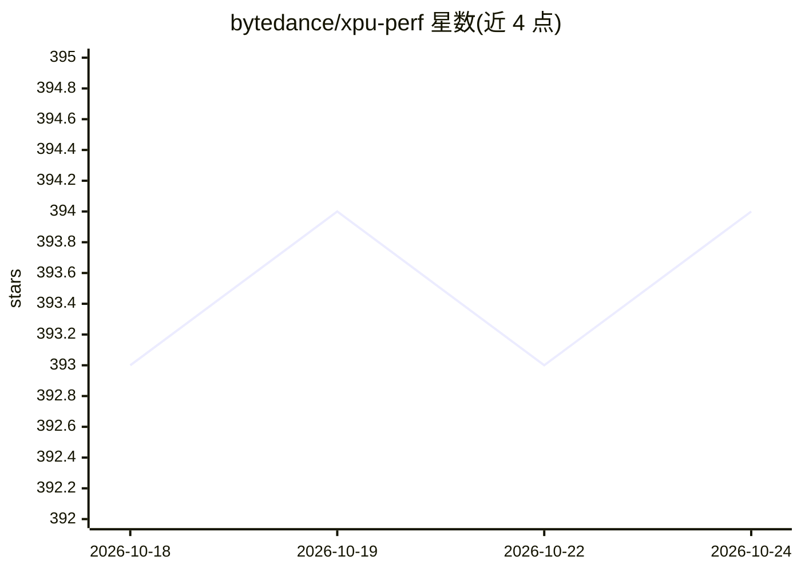

# bytedance/xpu-perf

⭐ 394 · Python · Apache-2.0 · 推送 2026-04-22 · [GitHub](https://github.com/bytedance/xpu-perf) · [官网](https://xpu-perf.ai/) · 组织维护 · 中文 README

**面向生产的 AI 加速器评测基准，覆盖算子到业务层**

字节跳动发布的 AI 加速器评测工程（HPCA 2026 论文关联），目标是打通芯片厂商、AI infra 引擎层、serving 层与业务层的评估链路。包含五个子项目：micro_perf 算子测试框架（衡量 MFU/MBU/CBU）、xpu_sim 模型端到端性能仿真、trace_gen 推理请求生成、train_perf 训练评估，以及标记为过时的 infer_perf（将转向 vllm/sglang 的 bench 能力）。README 未给出安装运行方式。

## 筛选速览

| 维度 | 判定 | 备注 |
|---|---|---|
| AI 角色 | `ai-ecosystem` | LLM/agent 周边工具 |
| 许可风险 | `permissive` | Apache-2.0 |
| 部署形态 | `None` |  |
| 模型依赖 | — | README 未给出锁定关系 |
| 硬件要求 | — | 无带数字的原话,不猜 |
| 安装摩擦 | `low` | 无编译、无系统依赖或容器化 |
| 成熟度 | — | 结构信号不足 |

## 能力要点

- micro_perf 算子测试框架，输出 MFU/MBU/CBU 利用率指标
- xpu_sim 提供 LLM、DiT 等场景的性能仿真（如 PD 分离性能）
- trace_gen 生成 LLM 推理请求以评估业务场景性能
- 配套 HPCA 2026 论文（字节跳动云原生 LLM 推理表征）

## 适用场景

- 评测特定芯片与软件栈的算子级性能表现
- 部署前仿真 LLM 分布式推理性能（如 PD 分离）
- 从业务视角评估具体部署形态的实际性能

## 场景标签

`模型评测` · 领域:评测与运维

## 证据(README 行号)

> L13: 3. 定义基础算子、特定应用场景（llm、dit等）专用算子，并提供高效的算子测试框架，用于评估衡量特定芯片、特定软件栈、特定算子库的综合性能表现，得到每个核心算子的MFU（算力利用率）、MBU（内存带宽利用率）、CBU（通信带宽
> L17: 5. 提供特定应用场景（llm推理、llm训练、dit推理等）的实测要求，衡量具体部署下的实际性能表现，比如特性芯片、特定模型、特定部署形态（并行方式+精度）、特定框架（比如vllm、sglang）上的prefill/decode

## 星数曲线

2026-10-18 393 → 2026-10-24 394（+1）

---
*卡片 v1 · prompt 1.4 · 生成 2026-10-21 · 置信度 high · 依据 README sha `446ee1447dee` · [字段定义](../../DATASET.md)*
