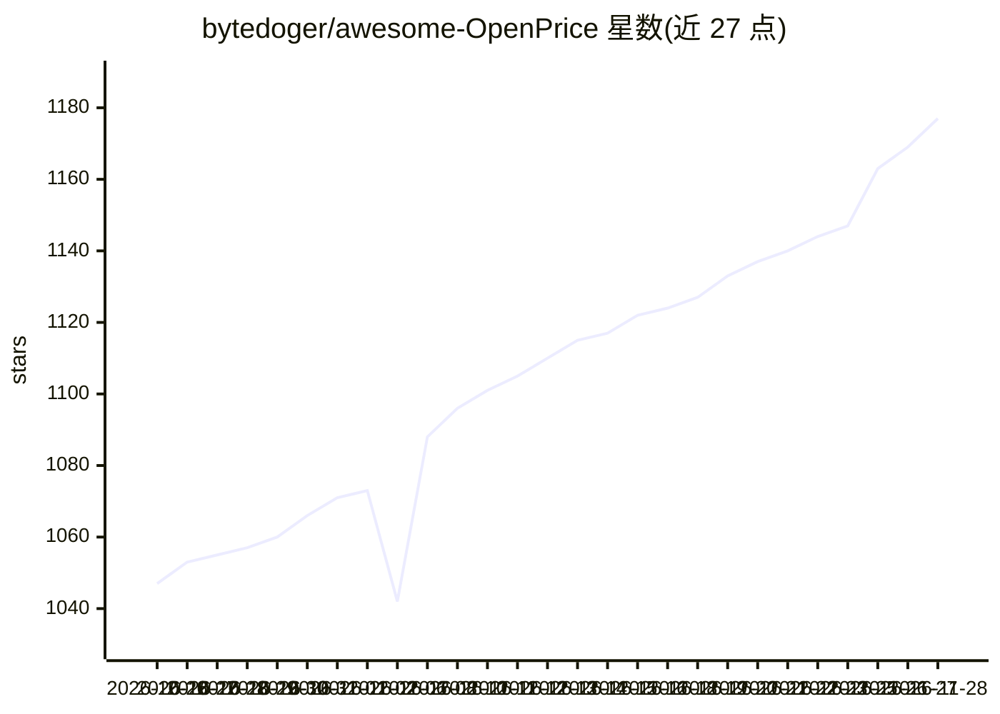

# bytedoger/awesome-OpenPrice

⭐ 1,177 · TypeScript · NOASSERTION · 推送 2026-11-18 · [GitHub](https://github.com/bytedoger/awesome-OpenPrice) · [官网](https://www.openprice.cc) · 个人维护 · 中文 README

**AI 订阅价格聚合与卡网渠道比价平台：查价与比价**

聚合展示 AI 产品订阅价格的比价平台：收集 ChatGPT、Claude、Gemini、Grok、Cursor 等产品的官方 App Store 各地区订阅价，以及卡网渠道（代充、成品号、日抛等）的报价，支持买家比价查询，也支持商家通过主流发卡系统一键收录或按 JSON-LD 规范接入。技术栈为 Next.js 14 + Supabase + Python 爬虫，提供本地部署流程。平台本身不销售商品、不参与交易；许可证为自定义协议，禁止商业运营与竞品化使用。

## 筛选速览

| 维度 | 判定 | 备注 |
|---|---|---|
| AI 角色 | `ai-knowledge` | 知识聚合/清单类 |
| 许可风险 | `none` | NOASSERTION |
| 部署形态 | `None` |  |
| 模型依赖 | — | README 未给出锁定关系 |
| 硬件要求 | — | 无带数字的原话,不猜 |
| 安装摩擦 | `low` | 无编译、无系统依赖或容器化 |
| 成熟度 | — | 结构信号不足 |

## 能力要点

- 聚合卡网渠道价格与官方 App Store 各地区订阅价格排行
- 支持链动小铺、独角数卡、二次元发卡等主流发卡系统一键接入，并提供 JSON-LD 接入规范
- 技术栈：Next.js 14 前端 + Supabase（PostgreSQL）+ Python 爬虫与规则分类引擎

## 适用场景

- 购买 AI 订阅前对比不同渠道与地区的价格
- 卡网商家免费提交渠道获得曝光
- 本地部署一套价格聚合站点做学习研究

## 场景标签

 · 领域:信息聚合/比价

## 证据(README 行号)

> L2: OpenPrice 是一个开源的 AI 订阅价格聚合与比价平台，专注于收录和比较不同平台、国家地区以及卡网渠道的 AI 产品价格。
> L54: * **全网价格透明化**: 实时聚合各卡网（如链动小铺、独角卡网等）渠道产品价格，最低价及质保服务一目了然。

## 星数曲线

2026-10-26 1,047 → 2026-11-28 1,177（+130）

---
*卡片 v1 · prompt 1.4 · 生成 2026-11-24 · 置信度 high · 依据 README sha `911ba9072d34` · [字段定义](../../DATASET.md)*
