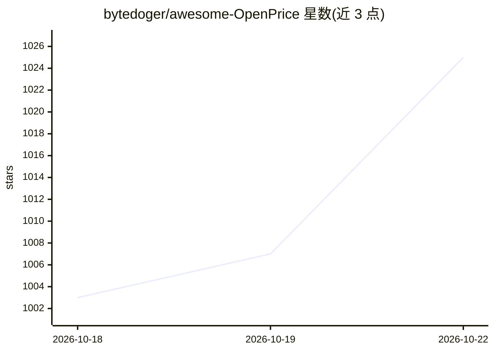

# bytedoger/awesome-OpenPrice

⭐ 1,035 · TypeScript · NOASSERTION · 推送 2026-08-27 · [GitHub](https://github.com/bytedoger/awesome-OpenPrice) · [官网](https://www.openprice.cc) · 个人维护 · 中文 README

**AI 订阅价格聚合与卡网渠道比价平台（开源自部署）**

基于 Next.js 14 + Supabase(PostgreSQL) 的价格聚合与比价 Web 平台：爬虫采集各卡网渠道（链动小铺、独角数卡、二次元发卡等）的 AI 产品报价，同时展示 ChatGPT、Claude、Grok 等应用在 App Store 不同地区的官方订阅价格供对比。面向买家（查价、比价）与卡网渠道商（免费提交收录、JSON-LD 接入规范）。仅做价格聚合展示，不参与交易；采用自定义许可协议，禁止未经书面授权的商业化运营与竞品化使用。自部署需 Node.js v18+、Python 3.8+ 与 PostgreSQL。

## 筛选速览

| 维度 | 判定 | 备注 |
|---|---|---|
| AI 角色 | `ai-enhanced` | 去掉 AI 部分产品仍成立 |
| 许可风险 | `none` | NOASSERTION |
| 部署形态 | `None` |  |
| 模型依赖 | — | README 未给出锁定关系 |
| 硬件要求 | — | 无带数字的原话,不猜 |
| 安装摩擦 | `low` | 无编译、无系统依赖或容器化 |
| 成熟度 | — | 结构信号不足 |

## 能力要点

- 聚合卡网渠道价格与官方订阅价格，支持按地区/套餐对比排行
- 商家一键免费收录，兼容主流发卡系统并提供 JSON-LD 接入规范
- Python 爬虫与规则分类引擎做数据采集和分类
- 技术栈：Next.js 14 / Tailwind / Supabase

## 适用场景

- 查询并比较不同渠道的 AI 订阅价格
- 卡网渠道商提交渠道获取曝光
- 自行部署一套价格聚合与展示站点

## 场景标签

 · 领域:AI 服务消费/比价平台

## 证据(README 行号)

> L2: OpenPrice 是一个开源的 AI 订阅价格聚合与比价平台，专注于收录和比较不同平台、国家地区以及卡网渠道的 AI 产品价格。
> L49: * **适合买家**：平台汇聚了全网绝大部分的卡网ai产品价格数据。无论是**代充、成品号、日抛、rt、at、带质保**等形式的 AI 产品（如 **Claude, GPT, Codex, Gemini** 等），还是非 AI 类

## 星数曲线

2026-10-18 1,003 → 2026-10-22 1,025（+22）

---
*卡片 v1 · prompt 1.4 · 生成 2026-10-21 · 置信度 mid · 依据 README sha `5038e3ee181d` · [字段定义](../../DATASET.md)*
