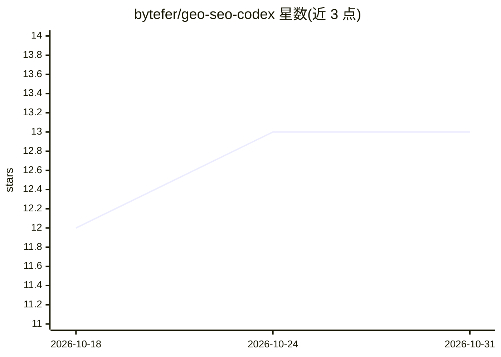

# bytefer/geo-seo-codex

⭐ 13 · Python · MIT · 推送 2026-07-01 · [GitHub](https://github.com/bytefer/geo-seo-codex) · [官网](https://www.bestalternative.dev/) · 组织维护

**面向 Codex 的 GEO/SEO 审计技能包：评估网站在 AI 搜索中的可见性**

以 Codex 技能包形式提供的 GEO（生成式引擎优化）与 SEO 审计工具：安装后向 Codex 注入 $geo 系列技能命令，可执行全站 GEO+SEO 审计并输出 0-100 综合评分（六类加权）、AI 爬虫可访问性检查、内容引用就绪度评分、llms.txt 生成与校验、Schema.org JSON-LD 验证生成、品牌权威信号扫描，以及面向客户提案与月度进度报告的轻量 CRM 功能。依赖 Python 3.8+ 与 Codex CLI，支持插件模式与经典安装两种方式，PDF 报告需可选的 Pandoc 与 Chromium。改编自 geo-seo-claude 项目。

## 筛选速览

| 维度 | 判定 | 备注 |
|---|---|---|
| AI 角色 | `ai-ecosystem` | LLM/agent 周边工具 |
| 许可风险 | `permissive` | MIT |
| 部署形态 | `library` | 以包/库形式分发 |
| 模型依赖 | — | README 未给出锁定关系 |
| 硬件要求 | — | 无带数字的原话,不猜 |
| 安装摩擦 | `low` | 无编译、无系统依赖或容器化 |
| 成熟度 | — | 结构信号不足 |

## 能力要点

- 六类加权的 0-100 综合 GEO 评分
- $geo 系列 17 个 Codex 技能命令（审计/爬虫检查/llms.txt/Schema 等）
- 客户级 Markdown/PDF 报告与提案、月度进度报告生成
- 支持 Codex 插件模式与 shell 安装脚本两种安装方式

## 适用场景

- 审计网站在 ChatGPT、Perplexity、Gemini 等 AI 搜索中的可见性
- 检查 AI 爬虫能否访问重要页面并生成 llms.txt
- 为 GEO 服务客户生成审计报告与月度进度报告

## 场景标签

 · 领域:SEO/营销分析

## 证据(README 行号)

> L13: (GEO) and SEO analysis. It installs `$geo` and `$geo-*` skill invocations into Codex and coordinates
> L60: Use this mode if you want Codex to load the project through

## 星数曲线

2026-10-18 12 → 2026-10-31 13（+1）

---
*卡片 v1 · prompt 1.4 · 生成 2026-10-31 · 置信度 mid · 依据 README sha `6712ab18a4ac` · [字段定义](../../DATASET.md)*
