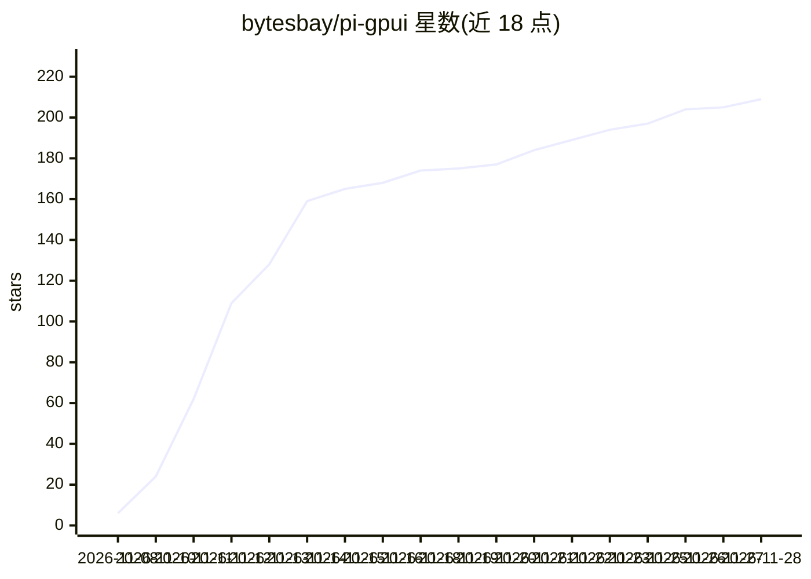

# bytesbay/pi-gpui

⭐ 209 · Rust · MIT · 推送 2026-11-23 · [GitHub](https://github.com/bytesbay/pi-gpui) · [官网](https://pi-gpui.dev) · 组织维护

**pi 编码 agent 的原生 GUI 客户端（Rust+GPUI，macOS/Linux）**

为终端里的 pi 编码 agent 提供桌面图形界面：通过 RPC 运行用户已安装的 pi，沿用其模型、扩展、技能与会话。功能含多项目多会话侧栏、slash 命令、会话树与全局会话搜索、图片粘贴、插件系统（工具调用内嵌实时视图）、上下文用量环与自更新。应用本体 16 MB，MIT 许可，Windows 不支持；要求 pi 1.4+，Linux 需 glibc 2.35+ 与 Vulkan 驱动（beta）。

## 筛选速览

| 维度 | 判定 | 备注 |
|---|---|---|
| AI 角色 | `ai-ecosystem` | LLM/agent 周边工具 |
| 许可风险 | `permissive` | MIT |
| 部署形态 | `desktop` | 安装包/桌面程序 |
| 模型依赖 | — | README 未给出锁定关系 |
| 硬件要求 | — | 无带数字的原话,不猜 |
| 安装摩擦 | `low` | 无编译、无系统依赖或容器化 |
| 成熟度 | — | 结构信号不足 |

## 能力要点

- Rust + GPUI 原生实现，无 Electron/webview
- 通过 RPC 复用已有 pi 的模型、扩展、技能与会话
- 任意语言插件：按钮、快捷键、工具与工具调用内嵌实时视图
- 会话树导航、分支摘要与跨项目会话正则搜索

## 适用场景

- 在图形界面管理多个项目的 pi 会话
- 把终端里开始的 pi 会话无缝转移到桌面窗口
- 为 pi 开发自定义插件与主题

## 场景标签

`编码 Agent` · 领域:编码与开发

## 证据(README 行号)

> L3: A native GUI for the pi coding agent, written in Rust with GPUI, the UI framework behind Zed. No Electron, no webvie
> L37: Needs pi 1.4 or newer within pi 1.x. The app finds pi in `PI_EXECUTABLE`, `PATH` or your login shell (so nvm instal
> L55: - Projects and their pi sessions in a sidebar. Every open session runs its own pi, so switching never stops work.

## 星数曲线

2026-11-08 6 → 2026-11-28 209（+203）

---
*卡片 v1 · prompt 1.4 · 生成 2026-11-25 · 置信度 high · 依据 README sha `ff9313a3288d` · [字段定义](../../DATASET.md)*
