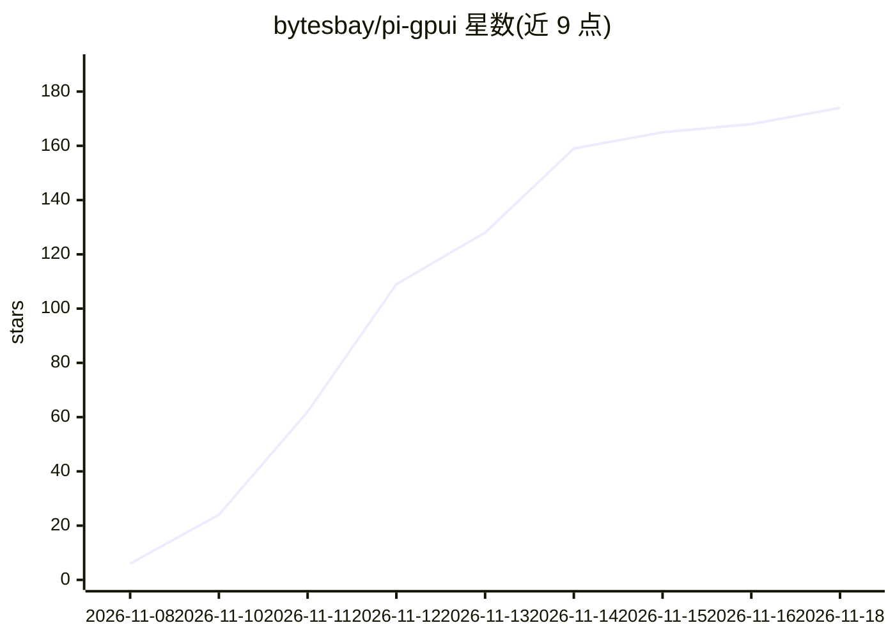

# bytesbay/pi-gpui

⭐ 174 · Rust · MIT · 推送 2026-11-17 · [GitHub](https://github.com/bytesbay/pi-gpui) · [官网](https://pi-gpui.dev) · 个人维护 · 中文 README

**为 pi 编程 agent 提供的原生 Rust 桌面 GUI（macOS/Linux）**

用 Rust 和 GPUI（Zed 的 UI 框架）编写的 pi coding agent 原生桌面客户端，无 Electron 与 webview。它通过 RPC 运行用户已安装的 pi，共享同一套模型、扩展、技能与会话，要求 pi 1.4+。提供会话树、斜杠命令、多项目侧栏、文件拖放、任意语言插件、每会话模型/思考级别、上下文环与压缩展示等。macOS 13+（Apple silicon）经 Homebrew 或签名下载包安装，Linux x86_64/arm64 为 beta（需 glibc 2.35+ 与 Vulkan 驱动），应用可自更新，Windows 不支持。

## 筛选速览

| 维度 | 判定 | 备注 |
|---|---|---|
| AI 角色 | `ai-ecosystem` | LLM/agent 周边工具 |
| 许可风险 | `permissive` | MIT |
| 部署形态 | `desktop` | 安装包/桌面程序 |
| 模型依赖 | — | README 未给出锁定关系 |
| 硬件要求 | — | 无带数字的原话,不猜 |
| 安装摩擦 | `low` | 无编译、无系统依赖或容器化 |
| 成熟度 | `idea` | |

## 能力要点

- 通过 RPC 复用终端中已有的 pi（模型、扩展、技能、会话一致）
- 原生 GPUI 界面：16 MB、约 0.4 s 启动、空闲约 75 MB 内存
- 任意语言插件系统，可在工具调用内绘制实时视图（内置 DOOM 演示）
- 每会话模型与思考级别、上下文环显示用量与 prompt 缓存命中

## 适用场景

- 在桌面图形界面中管理多个项目的 pi 编程会话
- 把终端里开始的会话经 /gpui 命令迁入图形界面继续
- 用插件扩展 pi 的工具与界面能力

## 场景标签

`编码 Agent` · 领域:编码与开发

## 证据(README 行号)

> L3: A native GUI for the pi coding agent, written in Rust with GPUI, the UI framework behind Zed. No Electron, no webvie
> L37: Needs pi 1.4 or newer within pi 1.x. The app finds pi in `PI_EXECUTABLE`, `PATH` or your login shell (so nvm instal

## 星数曲线

2026-11-08 6 → 2026-11-18 174（+168）

---
*卡片 v1 · prompt 1.4 · 生成 2026-11-17 · 置信度 high · 依据 README sha `3c56db72bb16` · [字段定义](../../DATASET.md)*
