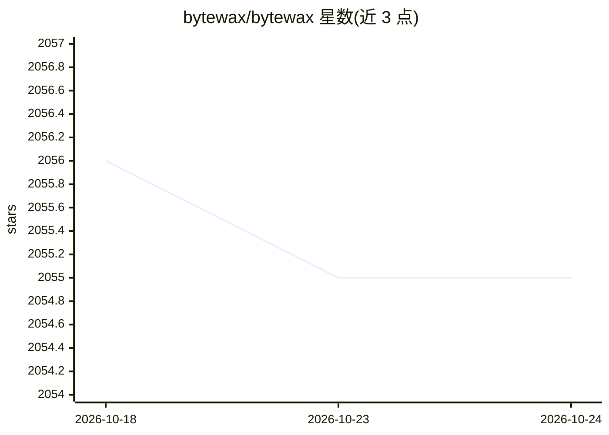

# bytewax/bytewax

⭐ 2,055 · Python · Apache-2.0 · 推送 2026-10-24 · [GitHub](https://github.com/bytewax/bytewax) · [官网](https://docs.bytewax.io/) · 组织维护

**Python 有状态流处理框架：用数据流算子构建事件处理管道**

Bytewax 是基于 Rust 执行引擎、以 Python 为接口的有状态流处理框架，采用类似 Flink/Spark 的数据流计算模型，提供 map/filter/fold_window/join 等算子和 Kafka、文件、stdio 等内置连接器。支持状态恢复、事件时间窗口与多机多 worker 横向扩展，可用于在线机器学习等有状态工作负载，配套 waxctl CLI 做 Kubernetes 部署。注意：原公司于 2025 年 5 月停止运营，项目转为社区维护（Apache-2.0），另有商业许可的 Bytewax Platform 产品。

## 筛选速览

| 维度 | 判定 | 备注 |
|---|---|---|
| AI 角色 | `ai-ecosystem` | LLM/agent 周边工具 |
| 许可风险 | `permissive` | Apache-2.0 |
| 部署形态 | `library` | 以包/库形式分发 |
| 模型依赖 | — | README 未给出锁定关系 |
| 硬件要求 | — | 无带数字的原话,不猜 |
| 安装摩擦 | `low` | 无编译、无系统依赖或容器化 |
| 成熟度 | — | 结构信号不足 |

## 能力要点

- Python API + Rust 引擎的数据流模型（有状态/无状态/窗口/连接算子）
- Kafka、文件、stdio 内置连接器，支持自定义连接器
- waxctl CLI 支持向 Kubernetes 集群部署与生命周期管理
- 状态恢复与事件时间窗口支持在线机器学习工作负载

## 适用场景

- 构建 Kafka 等数据源上的实时事件处理管道
- 做带状态恢复的在线机器学习与实时分析
- 从本地 python -m bytewax.run 起步再扩展到 Kubernetes 生产部署

## 场景标签

 · 领域:数据工程/流处理

## 证据(README 行号)

> L12: **Bytewax** is a Python framework and Rust-based distributed processing engine for stateful event and stream proces
> L16: - **Stateful Stream Processing:** Maintain and recover state automatically, enabling advanced online machine learni
> L58: **Stateful operations:** Bytewax maintains distributed state, allows for fault tolerance and state recovery, and su

## 星数曲线

2026-10-18 2,056 → 2026-10-24 2,055（-1）

---
*卡片 v1 · prompt 1.4 · 生成 2026-10-21 · 置信度 mid · 依据 README sha `f82f63055bd1` · [字段定义](../../DATASET.md)*
