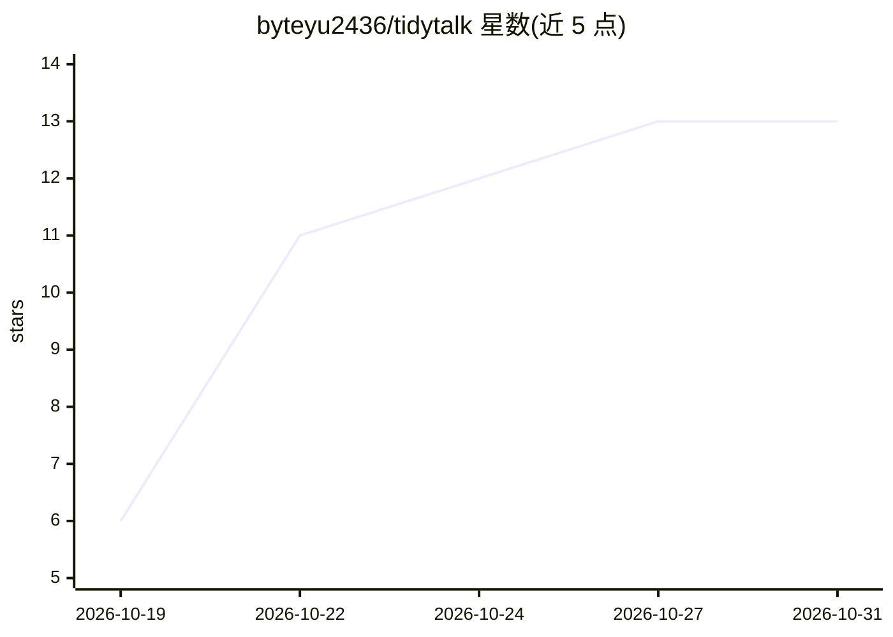

# byteyu2436/tidytalk

⭐ 13 · Swift · MIT · 推送 2026-10-28 · [GitHub](https://github.com/byteyu2436/tidytalk) · [官网](https://tidytalk.zayen.dev/) · 个人维护 · 中文 README

**Mac 本地语音输入工具：按住说话，松开得到整理后的文本**

macOS 菜单栏语音输入应用：按住快捷键说话，松开后本机完成语音识别（默认 SenseVoice，可选 Qwen3-ASR、Whisper 等），由 AI 去除口头语、修正口误与标点后粘贴到光标处。文本整理可选 Ollama/LM Studio 本地模型、Apple Intelligence 或 OpenAI 兼容云端服务。另提供会议录音、系统音频实时字幕、文件与链接转写功能。要求 macOS 26 以上 Apple Silicon Mac，通过 dmg 安装或源码构建。

## 筛选速览

| 维度 | 判定 | 备注 |
|---|---|---|
| AI 角色 | `ai-native` | 本体是模型或模型工具 |
| 许可风险 | `permissive` | MIT |
| 部署形态 | `desktop` | 安装包/桌面程序 |
| 模型依赖 | local-ok | 支持本地模型 |
| 硬件要求 | — | 无带数字的原话,不猜 |
| 安装摩擦 | `low` | 无编译、无系统依赖或容器化 |
| 成熟度 | — | 结构信号不足 |

## 能力要点

- 本机语音识别（SenseVoice/Qwen3-ASR/Whisper/macOS 自带），音频不上传
- 整理后端可选 Ollama、LM Studio、Apple Intelligence 或 OpenAI 兼容服务
- 会议录音转写、实时字幕、文件与 YouTube/Bilibili 链接转写导出 TXT/SRT/Markdown
- 转写同时可翻译为指定输出语言

## 适用场景

- 在聊天、邮件、编辑器里用语音快速输入整理后的文字
- 本地模型跑转写润色，语音数据不出本机
- 给会议、视频、讲座做本地转写与字幕

## 场景标签

`语音识别` · 领域:感知与多模态

## 证据(README 行号)

> L9: Hold a shortcut and say a paragraph. When you let go, Tidytalk recognizes your speech on your Mac, uses AI to remove
> L18: - **Your data stays on your Mac.** Speech is recognized locally with SenseVoice, and recordings are never uploaded.
> L20: - **Choose your speech model.** SenseVoice is the default. Switch to Qwen3-ASR for the best accuracy and recognitio

## 星数曲线

2026-10-19 6 → 2026-10-31 13（+7）

---
*卡片 v1 · prompt 1.4 · 生成 2026-10-31 · 置信度 high · 依据 README sha `1f4304958a2d` · [字段定义](../../DATASET.md)*
