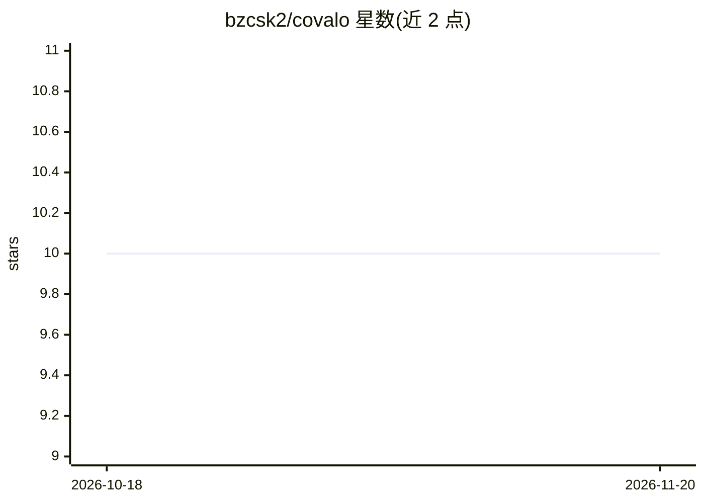

# bzcsk2/covalo

⭐ 10 · TypeScript · MIT · 推送 2026-11-04 · [GitHub](https://github.com/bzcsk2/covalo) · [官网](https://bzcsk2.github.io/covalo/) · 个人维护 · 中文 README

**让本地/低价模型完成实际编码任务的终端 Agent 运行时**

基于 TypeScript/Bun 的 CLI 与 TUI 编码 Agent 运行时，定位是让免费、低价或本地小模型完成真实工程工作。核心机制为 Supervisor/Worker 双角色循环：强模型负责规划、审查与恢复，低价模型执行实现；配合可调节的 harness 约束（更小步骤、更强验证门、有限重试）、检查点与会话恢复、缓存感知上下文、deny-first 权限引擎与文件快照回滚。提供 30+ 内置工具与 Skills/MCP/插件集成。当前为 pre-1.0，公共 API 与配置格式可能变化。

## 筛选速览

| 维度 | 判定 | 备注 |
|---|---|---|
| AI 角色 | `ai-native` | 本体是模型或模型工具 |
| 许可风险 | `permissive` | MIT |
| 部署形态 | `library` | 以包/库形式分发 |
| 模型依赖 | local-ok | 支持本地模型 |
| 硬件要求 | — | 无带数字的原话,不猜 |
| 安装摩擦 | `low` | 无编译、无系统依赖或容器化 |
| 成熟度 | `idea` | |

## 能力要点

- Supervisor/Worker 双角色执行循环，按模型强弱分工
- harness 机制针对弱模型/本地模型提供更严执行约束
- 会话持久化与崩溃恢复，检查点式进度报告
- deny-first 权限引擎、文件快照回滚与危险命令拦截

## 适用场景

- 用本地或免费模型在仓库中执行文件编辑与 shell 任务
- 长任务中让强模型监督弱模型执行并自动纠偏恢复
- 终端内可视化管理 Agent 会话、工具与模型切换

## 场景标签

`编码 Agent` · 领域:编码与开发

## 证据(README 行号)

> L12: **Covalo is a terminal-native AI loop agent for making cheap, free, and local models complete real engineering work
> L20: Covalo is a TypeScript/Bun CLI and TUI agent runtime with:

## 星数曲线

2026-10-18 10 → 2026-11-20 10（+0）

---
*卡片 v1 · prompt 1.4 · 生成 2026-11-19 · 置信度 high · 依据 README sha `827f38f66bac` · [字段定义](../../DATASET.md)*
